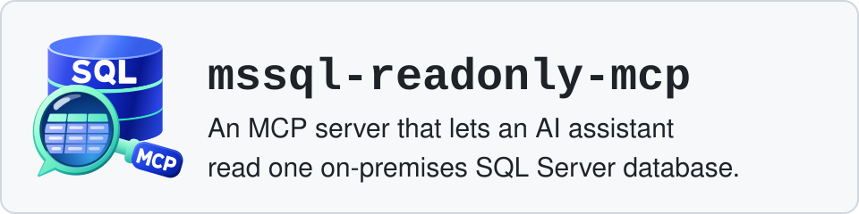

<picture>
  <source media="(prefers-color-scheme: dark)" srcset="docs/img/banner-dark.svg">
  
</picture>

[](https://github.com/oguzhanpisgin/mssql-readonly-mcp/actions/workflows/ci.yml) [](LICENSE)  [](#1-prerequisites)

# mssql-readonly-mcp

An MCP server that lets an AI assistant read one on-premises SQL Server database.
Its SQL tool accepts only text that passes an allowlist for one plain SELECT, and it will not start with a login
that fails its permission check (see "What `check-login` refuses" for what that check covers and what it does not).
It keeps a tamper-evident record (a hash-chained audit file) of every question asked.

Status: early release, actively maintained. Tested on SQL Server 2019, 2022 and 2025 (Linux container images) on
every change; what it promises, what it does not solve and how it was tested ("Building and testing") are written
below.

<picture>
  <source media="(prefers-color-scheme: dark)" srcset="docs/img/architecture-dark.svg">
  
</picture>

## What it promises

Each promise names the test files that check it. Test files are under `tests/`.

- **A write or DDL statement is refused before it reaches SQL Server.** The check is an allowlist over the
  ScriptDom syntax tree, not a keyword filter: a statement passes only when every node in its tree is on a
  hand-written list. Proven by `MssqlReadOnlyMcp.Gate.Tests/RegressionTableTests.cs` (allowed and refused rows,
  including the public bypass classes: stacked statements, `GO` batches, `EXEC` of a string, DML inside or after a
  CTE, conditional and nested comments, text hidden after a line comment), `StatementTypeTests.cs` (only one
  statement type is accepted, checked against every type in the ScriptDom assembly), and
  `MssqlReadOnlyMcp.IntegrationTests/GateRefusalTests.cs` (refused statements open no connection, create no
  command, and leave every table, the sequence and the object catalogue unchanged on a real SQL Server). On the
  server side, `ExtendedEventsTests.cs` traces the reader login with an Extended Events session: the refused set
  leaves no batch, RPC or login event, while an allowed query and a write sent past the gate on purpose do appear
  in the trace.
- **In every case tested, SQL Server ran the allowed text or refused it before running; in the lexer cases it ran,
  it read the first column name as the parser did.**
  `DifferentialTests.cs` sends every allowed row of the regression table to SQL Server as the reader; each must run
  or fail only on a missing name, except rows listed with the exact error the server gives.
  `ParserVersusServerLexerTests.cs` sends 335 lexer cases (invisible and separator characters in eight positions,
  comment and string forms, ODBC escapes): each is refused by the gate, or runs with one result set whose first
  column name is the name the parser saw, or is refused by the server. The test asserts the split exactly: 269
  refused by the gate, 61 allowed and read the same, 5 allowed and refused by the server. See SECURITY.md, "Where
  the parser and the server read text differently".
- **The server refuses to start with a login that fails its permission check.** At start it asks SQL Server about
  the login's rights on the server, the connected database and the classes listed in "What `check-login` refuses",
  and exits with code 3 on any finding. There is no override. Proven by `PermissionCheckTests.cs` and
  `StdioServerTests.cs` (`Started_with_sa_the_process_exits_3_with_one_stderr_line`).
- **No call returns data before its hash-chained audit line is written.** The line is appended after the
  SQL has run: if it cannot be written, the query has still run and the call returns an error and no data. For
  calls still running at an exit 6, see "Commands and exit codes". Proven
  by `MssqlReadOnlyMcp.IntegrationTests/AuditTests.cs` (one line per call plus one startup line; no data when the
  audit file fails), `StdioServerTests.cs`, and the `MssqlReadOnlyMcp.Audit.Tests` project (format, chain,
  verification, flush, single writer).
- **Results are capped by rows, characters and time.** Proven by `MssqlReadOnlyMcp.IntegrationTests/CapsTests.cs`
  (row cap, character cap, cell cut, command timeout, lock timeout).
- **A query waits a bounded time for locks and loses deadlocks against default-priority sessions.** Each session
  runs `SET LOCK_TIMEOUT` (default 5000 ms), `SET DEADLOCK_PRIORITY LOW`, `SET QUOTED_IDENTIFIER ON` and
  `SET NOCOUNT OFF` before the query (`src/MssqlReadOnlyMcp/SqlGateway.cs`).
  The lock timeout is proven by `CapsTests.cs` (`Exclusive_lock_held_elsewhere_returns_the_lock_timeout_reason_near_the_limit`).
  The deadlock priority is proven by `ValueTypeTests.cs`
  (`Deadlock_victim_is_reported_as_DeadlockVictim_and_the_next_call_works`): against a session at the default
  priority, the reader is the victim, and the next call works. Limit: while a query runs under the default READ
  COMMITTED level, its own shared locks can still make a writer wait, up to the command timeout.

## What it does not solve

Read this before you install it.

- **The rows the assistant reads leave your building.** They go to the AI vendor that runs the model, with the
  table and column names and any SQL Server error text. Read-only does not change that.
- **Personal data and cross-border transfer rules are the firm's decision.** In Turkey that is KVKK; other countries
  have their own rules. This project does not decide what may be sent.
- **The answer this project offers is the login.** `scripts/create-readonly-login.sql` creates a login that gets
  SELECT only on the tables and views the firm lists in the script. SQL Server shows that login only the user
  tables and views it holds a permission on, plus the names of objects that ship with SQL Server; a table without a
  grant is not found, not listed and not in `sys.objects` (`SchemaToolTests.cs`,
  `Table_without_a_grant_is_not_found_not_listed_and_not_in_sys_objects`).

More limits are in [SECURITY.md](SECURITY.md).

## Five-minute start

### 1. Prerequisites

- A .NET 10 SDK, 10.0.400 or later; `global.json` (`rollForward: latestFeature`) accepts a later 10.0 band, not 11.x.
- On Linux: the ICU libraries (for example the `libicu` package). The server turns globalization on because
  Microsoft.Data.SqlClient needs it.
- `sqlcmd`, to run the login script as a database administrator.
- The commands below are PowerShell 7 (`Read-Host -MaskInput` needs 7.1 or later).
- A SQL Server the machine can reach. The integration tests passed on 2026-11-12 on three Linux container images:
  `mcr.microsoft.com/mssql/server:2019-CU32-GDR13-ubuntu-20.04`, `2022-CU27-ubuntu-22.04` and
  `2025-CU9-GDR1-ubuntu-22.04`. Other versions and Windows installations were not tested.
- On SQL Server 2019 some allowed syntax is newer than the server: `IS [NOT] DISTINCT FROM`, the `WINDOW` clause,
  `TRIM(LEADING ...)`, `DATETRUNC`, `GREATEST` and `LEAST` pass the gate and fail on the server with a syntax error
  (156 or 102), or with error 195 (not a recognized built-in function: `DATETRUNC`, `GREATEST`, `LEAST`) (list
  `NewIn2022` in `tests/MssqlReadOnlyMcp.IntegrationTests/DifferentialTests.cs`). Nothing runs; the call returns
  `SqlError`.

Build it:

```powershell
git clone https://github.com/oguzhanpisgin/mssql-readonly-mcp.git
cd mssql-readonly-mcp
dotnet build -c Release
$dll = (Resolve-Path src/MssqlReadOnlyMcp/bin/Release/net10.0/mssql-readonly-mcp.dll).Path
```

The commands in this guide run from the repository root. The server is that DLL, started with `dotnet <path>` (on
Windows the build also writes `mssql-readonly-mcp.exe` beside it); the PowerShell steps use `$dll` from the last
line, so set it again in a new session. The JSON snippets cannot use a variable: they assume the clone is at
`C:/tools/mssql-readonly-mcp` and audit files under `C:/mcp-audit`. If yours differ, change every such path below
(the value of `$dll` is the DLL path to use).

### 2. Create the read-only login

Open `scripts/create-readonly-login.sql`. Its `GRANT SELECT ON OBJECT::...` lines are examples (a GRANT on an
object that does not exist stops the script): replace them with one line per table or view of yours the assistant
may read. Then run it as an administrator. Passwords come from environment variables, never from the file or the
command line. With Windows authentication (`-E`):

```powershell
$env:MCP_LOGIN = 'mcp_reader'
$env:MCP_DATABASE = 'ExampleDb'
$env:MCP_PASSWORD = Read-Host -MaskInput 'New password for mcp_reader'
sqlcmd -S sql.example.local -E -b -i scripts/create-readonly-login.sql
Remove-Item Env:MCP_PASSWORD
```

With a SQL Server administrator login (as the test does), after the same `MCP_` lines:

```powershell
$env:SQLCMDPASSWORD = Read-Host -MaskInput 'Password for the administrator login'
sqlcmd -S sql.example.local -U admin_login -b -i scripts/create-readonly-login.sql
Remove-Item Env:SQLCMDPASSWORD, Env:MCP_PASSWORD
```

Add `-C` only for a test server with a self-signed certificate (see step 3).

The script prints `Created login mcp_reader.` and `Created user mcp_reader in database ExampleDb.`, then lists the
permissions the user now holds and its role memberships (expected: none). It sets the login's default database to
`MCP_DATABASE`. A second run prints `Login mcp_reader exists; its password was not changed.` and reuses the user.
It stops with an error if the user belongs to another login or is in any role. `StdioServerTests.cs`
(`Setup_script_creates_a_login_that_passes_check_login_and_runs_twice`) runs this file unchanged in the test
container with `sqlcmd` from a Linux shell, then `check-login` (exit 0), then the file a second time. The PowerShell
lines above were not run by a test.

Do not add the login to `db_datareader`. See "What `check-login` refuses" below.

### 3. Check the login

Microsoft.Data.SqlClient encrypts the connection and checks the server certificate by default. An untrusted
certificate shows as exit code 4 with `SqlException number -2146893019` (seen on Windows with a self-signed
certificate). Install a trusted certificate, or, for a test server, add `TrustServerCertificate=True` to the
connection string (sqlcmd 18: `-C`) and accept that a machine in the middle is then not detected.

```powershell
$password = Read-Host -MaskInput 'Password for mcp_reader'
$env:MSSQL_CONNECTION_STRING = "Server=sql.example.local;Database=ExampleDb;User ID=mcp_reader;Password=$password"
dotnet $dll check-login
```

Exit code 0 and `Login mcp_reader on database ExampleDb: passed, no permission to change data was found.` means you
can go on. Exit code 3 prints `Login mcp_reader on database ExampleDb: refused, <n> right(s) outside the read-only
set found:`, then each finding on its own line after two spaces, for example `  UNMASK on database ExampleDb`; fix
those grants and run it again (`Program.cs`). When the server itself refuses to start, it exits 3 with one stderr
line that points to this command (`ServerStartup.cs`):

```text
mssql-readonly-mcp: refusing to start: the login holds rights beyond read-only access (2 findings, first: <finding>). Run 'mssql-readonly-mcp check-login' for the full list.
```

It says `1 finding` for one, and adds ` The startup audit line could not be written.` when that write failed too. In
both texts a finding names at most ten objects, then ` and <N> more` (`PermissionCheck.cs`). A refusal lists rights
outside the read-only set; a finding can be a right that only widens reading, for example `UNMASK`. The pass line
reports the outcome of the checks in "What `check-login` refuses", not a proof that the login cannot write.

### 4. Register with Claude Code

Claude Code reads a project file `.mcp.json` and expands `${VAR}` from the environment it was started in. The
secret stays in the environment, not in the file and not on a command line. (`claude mcp add --env NAME=value`
would put the password on a command line; do not use it for the connection string.)

Set the two variables for your user. These lines are for Windows; on Linux, `export` both variables in the shell
that starts Claude Code, from a file only you can read.

```powershell
$password = Read-Host -MaskInput 'Password for mcp_reader'
[Environment]::SetEnvironmentVariable('MSSQL_CONNECTION_STRING', "Server=sql.example.local;Database=ExampleDb;User ID=mcp_reader;Password=$password", 'User')
[Environment]::SetEnvironmentVariable('MSSQL_MCP_AUDIT_LOG', 'C:/mcp-audit/claude-code.jsonl', 'User')
```

A user variable reaches only processes started afterwards: quit and restart the application that launches Claude
Code (the terminal application or Claude Desktop), not only a tab. Until then `claude mcp list` warns about missing
environment variables and the server exits with code 2. Windows stores the variable in your registry hive
(`HKCU\Environment`) in plain text, password included, readable by any process running as you. To remove it:
`Remove-ItemProperty HKCU:\Environment -Name MSSQL_CONNECTION_STRING` (setting it to `$null` left an empty value).

`.mcp.json` at the project root:

```json
{
  "mcpServers": {
    "mssql-readonly": {
      "command": "dotnet",
      "args": ["C:/tools/mssql-readonly-mcp/src/MssqlReadOnlyMcp/bin/Release/net10.0/mssql-readonly-mcp.dll"],
      "env": {
        "MSSQL_CONNECTION_STRING": "${MSSQL_CONNECTION_STRING}",
        "MSSQL_MCP_AUDIT_LOG": "${MSSQL_MCP_AUDIT_LOG}"
      }
    }
  }
}
```

An entry with no `type` is a local stdio server. Source: <https://code.claude.com/docs/en/mcp>. A server from a
project `.mcp.json` shows as "Pending approval" in `claude mcp list` until you start `claude` once in that folder
and approve it; after that it is listed as connected.

The error number in step 3, the restart advice and exit code 2, the `$null` remark and "Pending approval" were seen
in a first run on 2026-11-12 on Windows with Claude Code; they are not covered by a test.

### 5. Register with Claude Desktop

The hand-edited `claude_desktop_config.json` form is documented on the MCP project's page
<https://modelcontextprotocol.io/docs/develop/connect-local-servers>, not on an Anthropic page. Anthropic's own
pages steer local servers to MCP Bundles (`.mcpb`); this project does not ship a bundle.

The file is `%APPDATA%\Claude\claude_desktop_config.json` on Windows,
`~/Library/Application Support/Claude/claude_desktop_config.json` on macOS. Open it from Settings > Developer >
Edit Config. Paths must be absolute; backslashes are doubled in JSON.

```json
{
  "mcpServers": {
    "mssql-readonly": {
      "command": "dotnet",
      "args": ["C:\\tools\\mssql-readonly-mcp\\src\\MssqlReadOnlyMcp\\bin\\Release\\net10.0\\mssql-readonly-mcp.dll"],
      "env": {
        "MSSQL_CONNECTION_STRING": "Server=sql.example.local;Database=ExampleDb;User ID=mcp_reader;Password=EXAMPLE-ONLY",
        "MSSQL_MCP_AUDIT_LOG": "C:\\mcp-audit\\claude-desktop.jsonl"
      }
    }
  }
}
```

That page documents no `${VAR}` expansion for this file, so the password sits in it in plain text. Limit who can
read the file. Quit Claude Desktop completely and start it again after editing. The server's stderr is in
`%APPDATA%\Claude\logs\mcp-server-mssql-readonly.log`.

Each server process needs its own audit file. The file is locked by one writer at a time through a companion
`<audit file>.lock` beside it (for example `claude-code.jsonl.lock`), which stays after the server exits; a second
server on the same file exits with code 2.

### 6. First question

Ask: "Use the mssql-readonly tools. List the tables, describe the orders table, then show the ten most recent
orders with their customer names."

Then run `verify-audit` on the audit file (see "The audit log").

## Reference

### Configuration

All settings are environment variables (`src/MssqlReadOnlyMcp/ServerConfig.cs`). A value that is not a whole number
or is out of range stops the start with exit code 2. A configuration error names the variable, never its value; an
audit file error names the audit file by its file name (`Program.cs`, `AuditLog.cs`). Connection pooling is left
at the client library's default (SECURITY.md, "Known limits", "Idle sessions stay open").

| Variable | Default | Range | Meaning |
| --- | --- | --- | --- |
| `MSSQL_CONNECTION_STRING` | none, required | | SQL Server connection string. The server adds `ApplicationIntent=ReadOnly` and `Application Name=mssql-readonly-mcp`. |
| `MSSQL_MCP_AUDIT_LOG` | none, required for the server | | Path of the audit file. Created with its folder if missing. Not needed by `check-login`. |
| `MSSQL_MCP_MAX_ROWS` | 200 | 1 to 5000 | Most rows `run_query` returns. |
| `MSSQL_MCP_MAX_CHARS` | 40000 | 1000 to 45000 | Most characters in one tool result. Claude Code saves a text result above 50,000 characters to a file instead of showing it, so the ceiling stays below that. |
| `MSSQL_MCP_TIMEOUT_SECONDS` | 30 | 1 to 300 | Command timeout of every command, the startup check included. Connecting uses the connection string's `Connect Timeout` (default 15 s). |
| `MSSQL_MCP_LOCK_TIMEOUT_MS` | 5000 | 0 to 300000 | Value of `SET LOCK_TIMEOUT` for every session. |

### Commands and exit codes

`src/MssqlReadOnlyMcp/Program.cs` and `ServerStartup.cs`.

| Command | What it does |
| --- | --- |
| (no argument) | Runs the stdio MCP server. Opens and verifies the audit file, runs the login check, writes a `startup` audit line, then serves. |
| `check-login` | Runs the login check only and prints the result. Needs `MSSQL_CONNECTION_STRING`. |
| `verify-audit <path>` | Verifies an audit file and prints the result. Needs no variable. |

| Exit code | Meaning |
| --- | --- |
| 0 | Success, including a normal server shutdown at end of input or Ctrl+C. |
| 1 | `verify-audit`: the file does not verify or cannot be read. |
| 2 | Configuration error (including a connection string the SQL Server client library rejects), audit file cannot be opened or does not verify, startup audit line not written, or wrong usage. |
| 3 | The login holds a permission outside the allowed set (see "What `check-login` refuses"). |
| 4 | SQL Server unreachable, or the check query failed (for example a wrong password). |
| 5 | An unexpected internal error. The stderr line names only the exception type. No test produces this code. |
| 6 | The server stopped while calls were still running. Only after Ctrl+C or a termination signal, never after end of input (see below). No test produces this code. |

Where output goes (`Program.cs`): `check-login` writes its result to stdout, the pass line or, with exit 3, the
header line and one line per finding; `verify-audit` writes its result to stdout with exit 0 and 1. Every other
failure, the server's own exit 3 included, is one line on stderr. The running server writes only MCP messages to
stdout, and to stderr one line per call, never the SQL text (`ToolService.cs`); its shape, an example, and the
shape of the warning described below:

```text
info: MssqlReadOnlyMcp.ToolService[0] <tool> <decision> <reason> <ms> ms
info: MssqlReadOnlyMcp.ToolService[0] run_query refused NotSelect 4 ms
warn: MssqlReadOnlyMcp.ToolService[0] <tool or unknown>: rejected before the tool ran (<exception type name>)
```

The `warn:` line is added for a call the SDK rejects by throwing (every rejection tested) before a tool runs; it
holds only the tool name and the exception type name, never the message or the arguments
(`ToolService.LogRejectedCall`; `StdioServerTests.cs`, `Calls_the_sdk_rejects_before_a_tool_runs_are_audited`).
For a connection string the client library rejects, the stderr line names only the exception type, for example
`mssql-readonly-mcp: configuration error: the SQL Server client library rejected MSSQL_CONNECTION_STRING (ArgumentException).`
(`StdioServerTests.cs`, `Connection_string_the_client_library_rejects_exits_2_with_one_line_from_the_type_name`).

At end of input the MCP SDK keeps the server running until every call in flight has ended on its own; each writes
its audit line, then the audit file closes and the process exits 0. Opening a call's connection is bounded by the
connect timeout, and the session settings and the query by the command timeout; the server sets no timeout of its
own for the rollback. Only the connect bound is exercised by a test. Tests: `StdioServerTests.cs`
(`Client_closing_stdin_after_a_call_ends_the_process_with_exit_0_and_no_error_line`,
`Call_in_flight_when_stdin_closes_writes_its_audit_line_before_the_process_ends`,
`Call_still_running_at_end_of_input_holds_the_process_past_the_drain_window_and_is_audited`) and `AuditTests.cs`
(`Shutdown_drain_waits_for_a_call_in_flight_before_the_log_closes`). On Ctrl+C or a termination signal the host's
own stop runs first (its shutdown timeout, 30 s by default; not tested), then the server waits at most
`MSSQL_MCP_TIMEOUT_SECONDS` plus 10 seconds for calls still running; if any remain, it writes one stderr line with
their number and exits 6 (`Program.cs`). Those calls return no data and may have no audit line. Ctrl+C is not
covered by a test, so whether it cancels calls in flight (they would be audited as `Cancelled`) is not known here.

### Tools

All three tools are marked read-only and non-destructive (`src/MssqlReadOnlyMcp/McpTools.cs`).
`list_tables` and `describe_table` run fixed catalogue queries; their argument reaches SQL Server only as a
parameter value (`SchemaQueries.cs`). Only `run_query` takes SQL, and that SQL goes through the gate.

| Tool | Arguments | Returns |
| --- | --- | --- |
| `list_tables` | `schema` (optional, at most 128 characters); `name_filter` (optional, at most 256 characters): a substring of the name, or a `LIKE` pattern when it contains `%` | JSON: `tables` (schema, name, kind: table or view) for the user tables and views the login can see, at most 500 per call; `row_count` (items returned), `total_count` (every match), `truncated`, `truncated_reason` (`max_items`, `max_chars` or null). |
| `describe_table` | `table` (required), for example `dbo.Orders`; at most 1035 characters (four fully bracketed parts) | JSON: schema, name, kind, `columns` (name, SQL type, nullable, identity, computed), `primary_key`, `foreign_keys`, `column_count`, `foreign_key_count`, `truncated`, `truncated_reason` (`max_chars` or null). A name in another database, or one the login cannot see, is answered `NotFound`. |
| `run_query` | `sql` (required, one SELECT, at most 65,536 characters); `max_rows` (optional, 1 or more; a value above the server cap uses the cap) | JSON: `columns` (name, type), `rows`, `row_count`, `truncated`, `truncated_reason` (`max_rows`, `max_chars`, `long_value` or null). |

`run_query` opens a new connection, runs the session settings, then sends the SQL text exactly as received inside
a transaction that is always rolled back (`src/MssqlReadOnlyMcp/ToolService.cs`). If SQL Server returns a second
result set (`MultipleResultSets`) or reports rows changed (`RowsChanged`), the call fails with no data. These are
diagnostics, not the barrier: they run after the server has executed the text. The barrier is the gate, the
transaction that is always rolled back, and the login's permissions checked at startup. When the first result set
was truncated, the command is cancelled before either can be seen. The session's `SET NOCOUNT OFF` keeps row counts
visible when the instance's `user options` turn NOCOUNT on for new sessions. Tests (`ValueTypeTests.cs`, text sent
past the gate on purpose as a `db_datawriter` member):
`Second_result_set_fails_as_MultipleResultSets_with_no_data_and_the_transaction_is_rolled_back`,
`Write_by_a_login_that_can_write_runs_inside_the_call_is_rolled_back_and_fails_as_RowsChanged`,
`Write_fails_as_RowsChanged_even_when_the_instance_turns_nocount_on_for_new_sessions` (with
`Session_runs_with_nocount_off`), and
`Limit_a_write_whose_first_result_set_is_truncated_is_not_seen_and_its_rows_are_returned_rolled_back`.

Every tool connection opens in the database the startup check ran in, even when the connection string names no
database and the login's default database changes later (`SqlGateway.PinnedTo`; `SchemaToolTests.cs`,
`Tools_run_in_the_checked_database_when_the_connection_string_names_none`).

Name arguments (`schema`, `name_filter`, `table`) that are too long, or that contain a character that is invisible
or that the server may read differently, are refused as `InvalidArgument` before any connection opens, and the
name is not recorded. Refused: control, format, line and paragraph separator characters, space characters other
than U+0020, U+FFFD, private-use, unassigned and noncharacter code points, and unpaired surrogates
(`ToolService.FindHiddenCharacter`). For example, SQL Server resolves a name with U+200D or U+FEFF to the object
without that character (`SchemaToolTests.cs`, `Name_with_a_zero_width_joiner_is_refused_although_sql_server_would_resolve_it`,
`Name_with_a_character_the_gate_refuses_outside_literals_is_an_invalid_argument`). Length limits on tool arguments
are counted in UTF-16 code units.

### Result limits

From `src/MssqlReadOnlyMcp/ResultPayload.cs` and `src/MssqlReadOnlyMcp.Gate/GateTypes.cs`:

- Rows: at most `MSSQL_MCP_MAX_ROWS`, or the caller's lower `max_rows`. The server stops reading and cancels the
  command; it does not rewrite the SQL to add `TOP`.
- Characters: the whole `run_query` result stays within `MSSQL_MCP_MAX_CHARS` whatever its ending, `long_value`
  included (`Long_value_ending_never_passes_the_character_cap`); rows that would pass it are left out and
  `truncated_reason` is `max_chars`.
- Cells: a text value longer than 2000 characters is cut and ends with `…[cut: value longer than 2000 characters]`.
  An `xml` value is returned as text and cut the same way (`ValueTypeTests.cs`).
- Binary values are returned as `<binary N bytes>`.
- Long values: a text or xml value over 1,048,576 characters, or a binary value over 1,048,576 bytes (shown as
  `<binary over 1048576 bytes>`), ends the result after its row with `truncated_reason` `long_value`. Later cells
  of that row read `<not read: an earlier value in the row is longer than 1048576>`. The server process never holds
  such a value whole, but the client library still reads the rest of it off the network when the reader closes,
  and discards it (`LargeValueTests.cs`, `One_very_large_cell_is_cut_and_never_held_but_the_rest_is_still_transferred`:
  a 200,000,000-character value; the test asserts that less than 64 MiB was allocated, and the 2026-11-12 run
  reported about 0.3 MB). `ValueTypeTests.cs` (`Binary_values_are_counted_up_to_one_mebibyte_only`) covers binary.
  This read limit holds for text and binary values. An xml value with one very large text node, or a large CLR
  value, may be read whole into memory by the client library before it is cut or named; not measured here. To see
  a long value, select `DATALENGTH(col)` or `SUBSTRING(col, 1, n)` instead of the column.
- CLR types are returned as `<unsupported value of type X>` and the call still succeeds. Tested with
  `hierarchyid`; `geometry` and `geography` take the same path in the source but have no test. To read such a column,
  convert it in the query, for example `CAST(Node AS nvarchar(4000))`, which returns `/1/2/` for a `hierarchyid`
  (`ValueTypeTests.cs`, `Hierarchyid_column_is_summarised_and_its_text_form_is_readable_by_cast`). The returned
  placeholder does not say this; it names only the type.
- A `decimal` too large for .NET is returned as its exact text.
- SQL text longer than 65,536 characters is refused (`TooLong`) without being parsed, and its text is not written to
  the audit line.
- `list_tables` and `describe_table` keep their answer within `MSSQL_MCP_MAX_CHARS` as well; items that would pass it
  are left out and `truncated_reason` is `max_chars` (`ErpScaleTests.cs`, `SchemaToolTests.cs`).
- Time: `MSSQL_MCP_TIMEOUT_SECONDS` per command, `MSSQL_MCP_LOCK_TIMEOUT_MS` per lock wait.

### Error reasons

A failed call comes back over stdio as a tool result with `isError: true` whose text starts with the reason word,
once, with no SDK prefix (`McpTools.cs`, `CallToolAuditFilter.cs`). The same word is the audit line's `reason`
(`src/MssqlReadOnlyMcp/ToolErrors.cs`, `src/MssqlReadOnlyMcp.Gate/GateTypes.cs`). `StdioServerTests.cs`
(`Every_failed_call_reaches_the_client_as_an_error_whose_text_starts_with_its_reason_word`) checks these texts (for
`SqlError` up to `line 1: `; the rest is SQL Server's message):

```text
NotSelect: refused by the read-only gate; DeleteStatement at line 1, column 1
InvalidArgument: max_rows must be 1 or more.
SqlError: SQL Server error 245, class 16, line 1: Conversion failed when converting the nvarchar value 'abc' to data type int.
InvalidRequest: the call was rejected before the tool ran (an argument is missing or has the wrong type); no data is returned.
```

An unknown tool name is not a tool result: the client gets the SDK's JSON-RPC error (`Unknown tool: 'no_such_tool'`).

Gate refusals, text `<reason>: refused by the read-only gate; <detail>`, or with no detail
`<reason>: refused by the read-only gate.` The detail names a node or token type, a line and a column; it never
repeats the SQL text.

| Reason | Meaning |
| --- | --- |
| `Empty` | No SQL text. |
| `TooLong` | Longer than 65,536 characters. |
| `ParseError` | Not valid T-SQL. |
| `NotSingleBatch` | A `GO` separator or more than one batch. |
| `NotSingleStatement` | Zero or more than one statement. |
| `NotSelect` | The statement is not a plain SELECT. |
| `SelectInto` | `SELECT ... INTO`. |
| `VariableAssignment` | `SELECT @v = ...`. |
| `DisallowedSyntax` | A syntax node, function name or character that is not on the allowlist. |
| `DisallowedTableHint` | A table hint other than `NOLOCK` or `READUNCOMMITTED`. |
| `DisallowedQueryHint` | An `OPTION (...)` clause or a join hint. |
| `LinkedServerName` | A four-part name. |
| `CrossDatabaseName` | A three-part name for a database other than the connected one. |
| `TooDeep` | More than 64 nested parentheses, or a tree too deep to check. |

Other errors, text `<reason>: ...`:

| Reason | Meaning |
| --- | --- |
| `Timeout` | The command timeout passed (SQL Server error -2). |
| `LockTimeout` | A lock wait passed the lock timeout (error 1222). |
| `DeadlockVictim` | SQL Server chose this query as the deadlock victim (error 1205). |
| `PermissionDenied` | SQL Server refused the login (error 229). |
| `SqlError` | Any other SQL Server error. |
| `NotFound` | `describe_table` found no table or view of that name. |
| `InvalidArgument` | A missing or invalid argument, for example `max_rows` below 1, a name argument that is too long, or a name with a hidden character. |
| `InvalidRequest` | The MCP SDK rejected the call before a tool ran: a missing or mistyped argument (text above), or an unknown tool name (audited only; the client gets the JSON-RPC error), or a request cancelled before the tool ran (audited only). The audit line has tool `unknown` for an unknown tool name and records no argument (`CallToolAuditFilter.cs`; `StdioServerTests.cs`, `Calls_the_sdk_rejects_before_a_tool_runs_are_audited`). |
| `MultipleResultSets` | SQL Server returned more than one result set; no data is returned. |
| `RowsChanged` | SQL Server reported rows changed by the text; the change was rolled back and no data is returned. |
| `ResultTooWide` | The column list alone is larger than the character cap. |
| `Cancelled` | The client cancelled the call. |
| `AuditUnavailable` | The audit line could not be written, so no data is returned. |
| `InternalError` | Anything else. No details are returned. |

A reason from a SQL Server error reads `<reason>: SQL Server error <number>, class <class>, line <line>`; for classes
11 to 16 and a positive error number, `: <server message>` follows (`ToolErrors.cs`). Such a message goes to the
assistant like a result, and can name objects or quote a value from the query or from a row (the `SqlError`
example above).

## What SQL is allowed

<picture>
  <source media="(prefers-color-scheme: dark)" srcset="docs/img/refused-query-dark.svg">
  
</picture>

`run_query` accepts one plain SELECT statement built only from these forms (node types listed in
`src/MssqlReadOnlyMcp.Gate/Allowlist.cs`, field `NodeTypes`: 84 types at the time of writing; recount with the
number of `typeof(` lines in that list):

- `SELECT` with `DISTINCT`, `TOP (n)` (also `PERCENT` and `WITH TIES`), `WHERE`, `GROUP BY` (also `ROLLUP`, `CUBE`,
  `GROUPING SETS`), `HAVING`, `ORDER BY`, `OFFSET ... FETCH`, and the `WINDOW` clause.
- `WITH` common table expressions, recursive ones too.
- `UNION`, `EXCEPT`, `INTERSECT`, and parenthesised queries.
- Joins: `INNER`, `LEFT`, `RIGHT`, `FULL`, `CROSS JOIN`, `CROSS APPLY`, `OUTER APPLY`; derived tables;
  `(VALUES ...) AS v(...)`; `PIVOT` and `UNPIVOT` with an aggregate from the list below.
- Subqueries, `CASE`, `CAST`, `CONVERT`, `TRY_CAST`, `TRY_CONVERT`, `COALESCE`, `NULLIF`, `IIF`, `LEFT`, `RIGHT`,
  `CURRENT_TIMESTAMP`, `AT TIME ZONE`, window functions with `OVER (PARTITION BY ... ORDER BY ... ROWS/RANGE ...)`
  and `WITHIN GROUP`.
- Predicates: comparisons, `AND`, `OR`, `NOT`, `BETWEEN`, `IN`, `LIKE`, `IS [NOT] NULL`, `EXISTS`,
  `= ANY / ALL / SOME (subquery)`, `IS [NOT] DISTINCT FROM`.
- Table hints `NOLOCK` and `READUNCOMMITTED` only.
- One-part and two-part names; three-part names only when the database part is exactly the connected database
  (same case).

Function names allowed in a function call (`Allowlist.cs`, field `FunctionNames`: 109 names at the time of writing,
compared ignoring case):

- Aggregates: `COUNT`, `COUNT_BIG`, `SUM`, `AVG`, `MIN`, `MAX`, `STDEV`, `STDEVP`, `VAR`, `VARP`, `STRING_AGG`,
  `GROUPING`, `GROUPING_ID`, `CHECKSUM_AGG`, `APPROX_COUNT_DISTINCT`.
- Ranking and window: `ROW_NUMBER`, `RANK`, `DENSE_RANK`, `NTILE`, `LAG`, `LEAD`, `FIRST_VALUE`, `LAST_VALUE`,
  `PERCENT_RANK`, `CUME_DIST`, `PERCENTILE_CONT`, `PERCENTILE_DISC`.
- String: `LEN`, `DATALENGTH`, `SUBSTRING`, `LTRIM`, `RTRIM`, `TRIM`, `UPPER`, `LOWER`, `REPLACE`, `REPLICATE`,
  `REVERSE`, `STUFF`, `CHARINDEX`, `PATINDEX`, `CONCAT`, `CONCAT_WS`, `FORMAT`, `STR`, `SPACE`, `QUOTENAME`, `ASCII`,
  `CHAR`, `NCHAR`, `UNICODE`, `TRANSLATE`, `STRING_ESCAPE`.
- Date and time: `GETDATE`, `GETUTCDATE`, `SYSDATETIME`, `SYSUTCDATETIME`, `SYSDATETIMEOFFSET`, `DATEADD`,
  `DATEDIFF`, `DATEDIFF_BIG`, `DATEPART`, `DATENAME`, `DATETRUNC`, `DATEFROMPARTS`, `DATETIMEFROMPARTS`,
  `DATETIME2FROMPARTS`, `TIMEFROMPARTS`, `EOMONTH`, `YEAR`, `MONTH`, `DAY`, `ISDATE`, `SWITCHOFFSET`,
  `TODATETIMEOFFSET`.
- Math: `ABS`, `ROUND`, `CEILING`, `FLOOR`, `SIGN`, `POWER`, `SQRT`, `SQUARE`, `EXP`, `LOG`, `LOG10`, `PI`, `SIN`,
  `COS`, `TAN`, `COT`, `ASIN`, `ACOS`, `ATAN`, `ATN2`, `DEGREES`, `RADIANS`.
- Null handling and choice: `ISNULL`, `ISNUMERIC`, `CHOOSE`, `GREATEST`, `LEAST`.
- JSON readers: `ISJSON`, `JSON_VALUE`, `JSON_QUERY`.
- Hashing and identifiers: `CHECKSUM`, `BINARY_CHECKSUM`, `HASHBYTES`, `NEWID`.

Anything not listed is refused by design, including a built-in that a later SQL Server version adds. That covers:

- user-defined functions (`dbo.fn(...)`) and table-valued functions, also system ones such as `sys.fn_get_audit_file`;
- variables (`@v`, `@@VERSION`), table variables and temporary tables (`#t`);
- table hints other than `NOLOCK` and `READUNCOMMITTED`, join hints and `OPTION (...)`;
- cross-database and linked-server names, `OPENQUERY`, `OPENROWSET`, `OPENDATASOURCE`, `OPENJSON`, `OPENXML`;
- `FOR XML`, `FOR JSON`, `WITH XMLNAMESPACES`, `NEXT VALUE FOR`;
- metadata and identity functions (`OBJECT_ID`, `DB_NAME`, `CURRENT_USER`, `SESSION_USER`, `SYSTEM_USER`, `USER`
  and the rest), `PARSE`, the JSON builders, and `CURRENT_DATE`.

If you need a function that is not listed, open an issue with the query you wanted to run. A name is added only
after it is checked not to reach outside the query or expose metadata or security material.

### Checks on the text and the tokens

These checks can only refuse; they run before or beside the syntax tree (`src/MssqlReadOnlyMcp.Gate/ReadOnlyGate.cs`).
Each refusal is `DisallowedSyntax` unless named otherwise.

- Before parsing, anywhere in the text (also inside literals and comments): text that is not well-formed UTF-16
  (an unpaired surrogate), and the 66 Unicode noncharacters (U+FDD0 to U+FDEF, and the last two code points of
  every plane).
- ODBC escape tokens outside literals, quoted names and comments: `{fn ...}`, `{d ...}`, `{oj ...}` and any other
  brace, and `--(*`. So `LIKE 'a\_b' {escape '\'}` is refused, while `LIKE 'a\_b' ESCAPE '\'` is allowed. A brace
  inside a string literal or a comment is allowed.
- Outside literals and comments: Unicode space characters other than U+0020, line and paragraph separators, format
  characters (for example U+200B, U+200D, U+FEFF), control characters other than TAB, CR and LF, U+FFFD, private-use
  and unassigned code points.
- Inside bracketed and double-quoted names: the same space, separator, format and control characters.
- A line comment (`--`) that contains a control character other than TAB, or a line or paragraph separator.
- A `GO` token anywhere (`NotSingleBatch`); more than 64 nested parentheses (`TooDeep`).

The gate parses with `TSql170Parser` (`ReadOnlyGate.cs`), which the package documents as the parser for version
17.0; the package also ships `TSql180Parser`, which the gate does not use. `StatementTypeTests.cs`
(`ScriptDom_is_at_least_the_version_with_the_U_FFFF_end_of_input_fix`) asserts that the loaded ScriptDom file is
version 18.0.140.0 or later (NuGet package 180.140.0); earlier versions stopped reading at U+FFFF.

The regression table (`tests/MssqlReadOnlyMcp.Gate.Tests/RegressionTableTests.cs`) has 71 allowed and 247 refused
rows at the time of writing (count the `Ok(` and `No(` rows).

### What `check-login` refuses

The check runs one query (`src/MssqlReadOnlyMcp/PermissionCheck.cs`) and refuses the login when it finds any of:

- an effective server permission other than `CONNECT SQL` and `VIEW ANY DATABASE`;
- an effective permission on the connection's database other than `CONNECT`,
  `VIEW ANY COLUMN ENCRYPTION KEY DEFINITION` and `VIEW ANY COLUMN MASTER KEY DEFINITION`;
- membership of any fixed server role other than `public`, or of `db_owner`, `db_datawriter`, `db_ddladmin`,
  `db_securityadmin`, `db_accessadmin` or `db_backupoperator`;
- below database scope, on every object of the asked types in the connection's database's `sys.objects`, those
  SQL Server marks as shipped (`is_ms_shipped = 1`) included: write, alter, control and ownership rights on tables,
  views and inline functions, column `UPDATE`, sequences, procedures and functions (also `EXECUTE`), and synonyms
  (also `EXECUTE`);
- write, alter, control and ownership rights on schemas (also `EXECUTE` and `CREATE ...`), `ALTER`, `CONTROL` and
  `TAKE OWNERSHIP` on roles, `ALTER` and `CONTROL` on application roles (scope `application role`), `IMPERSONATE`
  on users and logins, and `ALTER`, `CONTROL` and `TAKE OWNERSHIP` on user-defined server roles (scope
  `server role`, with the role's name);
- on Service Broker queues, the built-in ones in schema `dbo` included (three in a user database), a fixed list:
  `RECEIVE`, `ALTER`, `CONTROL` and `TAKE OWNERSHIP` (scope `queue`);
- on services, certificates, asymmetric keys, symmetric keys, assemblies (the built-in `Microsoft.SqlServer.Types`
  included), user types, XML schema collections outside schema `sys`, full-text catalogs, message types,
  contracts, remote service bindings, routes, full-text stoplists, search property lists, database scoped
  credentials and endpoints (scopes `service`, `certificate`, `asymmetric key`, `symmetric key`, `assembly`, `type`,
  `xml schema collection`, `full-text catalog`, `message type`, `contract`, `remote service binding`, `route`,
  `full-text stoplist`, `search property list`, `database scoped credential`, `endpoint`): every right SQL Server
  lists for the class (`sys.fn_builtin_permissions`) except `VIEW DEFINITION`, `REFERENCES`, `EXECUTE` on a table
  type, an alias type or an XML schema collection, and `CONNECT` on an endpoint; an owner holds `CONTROL` without a
  grant row and is found here;
- as a backstop, any right granted (state `G` or `W`) on a securable of the connection's database
  (`sys.database_permissions`) or of the server (`sys.server_permissions`), whatever its class, to the login, to a
  role or group it is in, or to `public`, except `CONNECT` and `VIEW DEFINITION`, and on a database securable also
  `SELECT`, `REFERENCES`, `VIEW CHANGE TRACKING`, `UNMASK` and `EXECUTE` on a table type, an alias type or an XML
  schema collection, and, in `master` only, `public`'s `EXECUTE` on system objects (see the backstop paragraphs
  below). Database-wide and server-wide grants are left to the first two items;
- any right those items allow, held `WITH GRANT OPTION` (state `W`) by the login, a role or group it is in, or
  `public`, also the rights allowed on the database and the server: the login can grant it to others. The finding
  is `<right> WITH GRANT OPTION on <scope> [<name>]`, for example `SELECT WITH GRANT OPTION on schema [dbo]`,
  `CONNECT WITH GRANT OPTION on database ShopDb` or `VIEW ANY DATABASE WITH GRANT OPTION on server`. A refused
  right held `WITH GRANT OPTION` keeps its one finding (`INSERT on object [dbo].[Customers]`).

The server and database allowed sets are what a login made by `scripts/create-readonly-login.sql` holds on SQL
Server 2019, 2022 and 2025 (code comment in `PermissionCheck.cs`). Any other permission is a finding by its own
name, so one that a later SQL Server version adds is refused without a code change. "Effective"
(`sys.fn_my_permissions`) includes rights that roles and higher scopes imply, and rights that only widen reading:
database-wide `SELECT`, `UNMASK`, `CONNECT ANY DATABASE` and `SELECT ALL USER SECURABLES` are refused too, as are
read-only database grants such as `VIEW DEFINITION`, `SHOWPLAN` and `VIEW DATABASE STATE`, so a platform that grants
such extras by default will see its logins refused. The query counts a NULL answer as a finding
(`ISNULL(state, 1) = 1`, printed as `could not be checked`), never a pass; its test
(`Null_answer_is_a_finding_named_could_not_be_checked`) checks only how the finding is printed, and no test produces
a NULL answer.
`PermissionCheckTests.cs` covers the reader passing and, among others, `sa`, `db_owner`, `db_datawriter`, single
table and column `UPDATE`, `IMPERSONATE`, `ALTER TRACE` (with the `SHOWPLAN` it implies), `BACKUP DATABASE`,
`UNMASK`, `TAKE OWNERSHIP` on a role and `UPDATE` on a synonym (`UPDATE on synonym [dbo].[CustomerAlias]`).
`CONNECT ANY DATABASE`, `SELECT ALL USER SECURABLES`, `VIEW DEFINITION` and `VIEW DATABASE STATE` follow from the
rule and have no test of their own. A synonym counts because, with an unbroken ownership chain, `UPDATE` granted on
the synonym alone changes the table it names, measured on 2019, 2022 and 2025 (`ValueTypeTests.cs`,
`Update_grant_on_a_synonym_alone_lets_the_login_change_the_table_it_names`; inside this server the call still fails
as `RowsChanged` and is rolled back). The check reports such a grant even when the synonym's target is in another
database, on a linked server or behind a broken ownership chain, where SQL Server also asks for the right on the
target (not tested here); the login is then refused although it may not be able to write through that synonym.

Objects that SQL Server marks as shipped (`is_ms_shipped = 1`) in the connected database are asked like any other
object of the asked types. Two cases were measured on 2019, 2022 and 2025 (`PermissionCheckTests.cs`): a procedure
and a table marked with `sp_MS_marksystemobject`, where a login with `EXECUTE` on the procedure and `INSERT`,
`DELETE` on the table gets `DELETE on object [dbo].[MarkedNotes]`, `EXECUTE on object [dbo].[AddLedger]` and
`INSERT on object [dbo].[MarkedNotes]` and can run the procedure (it writes a row) and the insert; and the tables
that change data capture adds in schema `cdc` (`sys.sp_cdc_enable_db`), where `DELETE` on `cdc.ddl_history` gives
`DELETE on object [cdc].[ddl_history]` and the delete runs. The reader can do none of it (error 229).

Connected to `msdb`, a login with a user there is refused (measured for a reader with `SELECT` on schema `dbo`;
every user is in `public`), because `public` may execute shipped procedures and functions in schema `dbo` there:
`fn_sysdac_is_currentuser_sa`, `fn_sysdac_is_dac_creator`, `fn_sysdac_is_login_creator`,
`fn_syspolicy_is_automation_enabled`, ten procedures named `sp_sysdac_*` and, on 2022 and 2025,
`sp_sysutility_cag_create_db`: 14 objects on 2019 and 15 on 2022 and 2025, reported as one finding,
`EXECUTE on object [dbo].[fn_sysdac_is_currentuser_sa], ...`, that names the first ten and ends `and 4 more` on
2019 or `and 5 more` on 2022 and 2025. A login without a user in `master` or `msdb` enters as `guest` and is
refused for schema `[guest]` (`ALTER`, `CONTROL`, `CREATE SEQUENCE`, `DELETE`, `EXECUTE`, `INSERT`,
`TAKE OWNERSHIP` and `UPDATE`, measured). Point the server at the database it reads, with a user for the login
there.

A finding on a shipped object that you did not grant to the login comes from a grant that reaches it another way,
for example through `public` or a role it is in, as in `msdb`; find it in that database's
`sys.database_permissions`. A grant to `public` reaches every user there. A plain reader (a user with `SELECT` on
schema `dbo`) had no such finding, and no finding at all, in `master`, in a new user database, in a database with
change data capture enabled (`sys.sp_cdc_enable_db`), in a database where two tables were also enabled for capture
with `sys.sp_cdc_enable_table`, one with a gating role and one without (SQL Server Agent was not running and did
not have to run), and in a database with change tracking enabled on the database and on one table. With captured
tables SQL Server grants `SELECT` on the change functions and on `cdc.lsn_time_mapping` to `public` or to the
gating role, a right the check allows. Measured on the three versions. A database with replication or with
database diagrams was not measured.

A plain reader is refused in a database with a system-versioned temporal table, and on 2022 and 2025 with an
updatable ledger table. SQL Server reports `INSERT` on the history table for a login that holds `SELECT` on it
(`sys.fn_my_permissions` lists `SELECT` and `INSERT`), so the check finds `INSERT on object` naming the history
table (`[dbo].[PricesHistory]`, `[dbo].[MSSQL_LedgerHistoryFor_<object_id>]`; one finding names both when both are
in the database). On SQL Server 2019 that answer holds for the temporal history table: as the plain reader,
`INSERT INTO @t OUTPUT ... INTO dbo.PricesHistory` ran and added a row, seen inside the transaction, which was
rolled back. On 2022 and 2025 that statement failed with error 13559. On all three versions a direct `INSERT`,
`INSERT ... SELECT` and an insert through a view or a synonym failed with error 13559, `MERGE` with 13562, `UPDATE`
with 13561 and `DELETE` with 13560, for `sa` too; on the ledger history table `INSERT` and `OUTPUT ... INTO` failed
with error 37361, also for `sa`. The check refuses the reader on all three versions. `DENY INSERT` on the history
table, or on the schema, did not change that answer: the reader was still refused. A reader granted `SELECT` on the
current tables only passes, but
cannot read the history (`FOR SYSTEM_TIME ALL` fails with error 229). No grant was found that lets a login read the
history and pass the check. Measured on the three versions (the ledger table on 2022 and 2025). In such a
database, grant `SELECT` on the current tables by name, as `scripts/create-readonly-login.sql` does, not on their
schema; a login that passes the check cannot read the history.

`ALTER` on an application role lets the login change the role's default schema; a new name, a new password or
`DROP` failed with error 15151 under that right (SQL Server documents `ALTER ANY APPLICATION ROLE` for them).
`CONTROL` granted alone on an application role is found as `ALTER` and `CONTROL`, and allowed the same act and
none of the other three. `ALTER` on a user-defined server role lets the login add itself as a member, and a member
holds the role's rights (measured with a role holding `ALTER ANY LOGIN`). `CONTROL` granted alone on such a role is
found as `ALTER`, `CONTROL` and `TAKE OWNERSHIP` and also let the login add itself; `TAKE OWNERSHIP` granted alone
is found as itself and let the login make itself the role's owner (`ALTER AUTHORIZATION`). The findings name the
role (`ALTER on application role [reporting_app]`, `ALTER on server role [mcp_login_admins]`). Each act was rolled
back, the plain reader got error 15151 for each, and all of it was measured on the three versions; what an owner
of a server role can do after taking it was not measured. These rights are not asked of the fixed server roles
and `public`: SQL Server refuses those three grants on them (error 15151). Membership of the fixed server roles is
asked instead.

A `db_datareader` member is refused: the role gives `SELECT` on the whole database, and SQL Server makes the role
the owner of schema `db_datareader`, so its members can create objects there (`CONTROL on schema [db_datareader]`,
`CREATE SEQUENCE on schema [db_datareader]`, `SELECT on database ...`). `PermissionCheckTests.cs` shows that such a
member really can create a sequence in that schema. Grant SELECT on named tables, views or schemas instead, as
`scripts/create-readonly-login.sql` does.

The class rules were measured on 2019, 2022 and 2025 by granting each right alone and trying what it enables.
The queue list is fixed because SQL Server cannot grant `INSERT`, `UPDATE`, `DELETE` or `EXECUTE` on a queue (error
4606) and refuses `INSERT` and `DELETE` on one even for `sa` (error 416); `RECEIVE` takes messages off it, and `SELECT`
only reads it. The built-in queues are asked like user ones (three in a user database or `master`, six in
`msdb`): `RECEIVE` on `dbo.QueryNotificationErrorsQueue` lets the login begin a dialog from that queue's built-in
service, owned by `dbo`, and send a message to a user service's queue. For the other sixteen classes the rule is the
one used at server and database scope: allow what is listed, refuse the rest, so a right that a later version adds
is refused without a code change. The built-in assembly `Microsoft.SqlServer.Types` (owner `sys`) is asked too.
SQL Server accepts a grant of `ALTER`, `CONTROL` or `TAKE OWNERSHIP` on it, and the check finds each. On this system
assembly SQL Server still refuses `ALTER ASSEMBLY` and `DROP ASSEMBLY` to all three logins (error 15151; `DROP`
under `CONTROL` gives 6560, "a system assembly"). `ALTER AUTHORIZATION` works under `CONTROL` or `TAKE OWNERSHIP`
and makes the login the assembly's owner; under `ALTER` alone it fails with 15151. Built-in types and the XML schema
collection `sys.sys` are not asked because SQL Server refuses every right the class lists on them (error 15151 on a
built-in type, 4606 on `sys.sys`). `VIEW DEFINITION` and `REFERENCES` changed nothing and ran no code: on a
certificate or an asymmetric key they let the login encrypt with the public key only, on a symmetric key protected
by a password they let a login that knows the password use the key (see the limits below), and the `CREATE`
statements that use `REFERENCES` on an assembly, a type or an XML schema collection were refused for want of the
`CREATE` right (error 262). `EXECUTE` on a table type or an XML schema collection only declares a variable, and on
an alias type it adds nothing; `EXECUTE` on a CLR type runs the assembly's code and is a finding
(`EXECUTE on type [dbo].[Point]`). An owner holds `CONTROL`, which is a finding.
Message types, contracts, remote service bindings, routes, full-text stoplists, search property lists, database
scoped credentials and endpoints are asked so that an owner is found, who holds `CONTROL` without a grant row.
Measured on the three versions for each of these eight classes: the owner (made so with `ALTER AUTHORIZATION`) saw
the securable, `HAS_PERMS_BY_NAME` answered 1 for every right the class lists, the check found
`ALTER`, `CONTROL` and `TAKE OWNERSHIP` on it, and the owner ran a change the reader could not (listed below).
`VIEW DEFINITION` and `REFERENCES` are allowed on them as on the other classes, and `CONNECT` on an endpoint is
allowed because `public` holds it on the T-SQL endpoints. A member of a role that owns a securable is found the
same way: measured on the three versions for a schema, a message type and a full-text stoplist owned by a database
role, and for a database mirroring endpoint and a user-defined server role owned by a server role
(`PermissionCheckTests.cs`; no act was run through a role).

`SEND` on a service lets a dialog begun in a `TRUSTWORTHY` database put a message on the service's queue. `SEND`
alone does not make the service visible to the login, so the backstop (below) finds the grant in
`sys.database_permissions` and names the service by id, once however many grants reach the login:
`SEND on service id <service_id>`. Some Service Broker setups grant `SEND` on
a service to `public`; that grant reaches every login, so every login is refused in that database (measured for the
plain reader: `SEND on service id 65536`). As with a platform that grants extras by default, revoke it from
`public` and grant `SEND` to the senders that need it, or point the server at another database.

The check finds these securables in the catalog views, which show a login only those it holds some right on.
Measured on all three versions, a single grant of any right the check refuses on these classes made the securable
visible, except `SEND` on a service (read from `sys.database_permissions`, as above); of the allowed rights,
`EXECUTE` on a table type made it visible and `EXECUTE` on an XML schema collection did not. Visibility under
`VIEW DEFINITION` or `REFERENCES` alone was not measured. The built-in queues and `Microsoft.SqlServer.Types` are
visible to the plain reader. The owner of a message type, a contract, a remote service binding, a route, a
full-text stoplist, a search property list, a database scoped credential or an endpoint saw it and the plain
reader did not (measured on the three versions).

`PermissionCheckTests.cs` gives one or more logins per class their exact findings (a built-in queue and the
built-in assembly included, and a login holding `SEND` both directly and through a role, named once), passes a
login holding `VIEW DEFINITION` on each of these classes, `REFERENCES` on each except the queue and the service (a
service has no `REFERENCES` right; the queue has one, not granted to this login) and `EXECUTE` on a table type, an
alias type and an XML schema collection (the eight classes added for owners have no such login: that
`VIEW DEFINITION` and `REFERENCES` pass on them follows from the rule, no test), and runs at least one act for each
refused login except the two that hold
`SEND` through a role, while the reader cannot: a message received, a message sent from a built-in queue's service,
a service's contract dropped, a certificate signing, a private key removed, a symmetric key's owner changed, the
built-in assembly's owner changed, an assembly file added, a CLR method run, an XML schema collection altered, a
catalog rebuilt, a message delivered from another database. The other found rights (for example `TAKE OWNERSHIP`
on a certificate or a catalog) have no act of their own. The owners of the eight classes added for owners get
`ALTER`, `CONTROL` and `TAKE OWNERSHIP` on their securable and each runs one change while the reader cannot: a
message type's validation changed, a contract dropped, a remote service binding's `ANONYMOUS` setting changed, a
route's address changed, a credential's identity changed, a stoplist dropped and created again, a property added
to a search property list, an endpoint's port changed and set back. A member of a role that owns a schema, a
message type, a full-text stoplist, an endpoint or a server role gets its exact findings, with no act.

Limits of the class rules:

- `REFERENCES` on a full-text catalog is allowed; what it is for, `CREATE FULLTEXT INDEX`, could not run in the
  test images because full-text search is not installed, so that use was not measured.
- `REFERENCES` or `VIEW DEFINITION` on a symmetric key protected by a password, plus that password, opens the key:
  the login can then encrypt and decrypt with it (measured). The check allows it because it changes nothing,
  although it widens what the login can read, unlike `UNMASK` or database-wide `SELECT`, which the check refuses.
  Do not give such a login the key's password unless it should read that data.
- On a queue the class rule asks only `RECEIVE`, `ALTER`, `CONTROL` and `TAKE OWNERSHIP`; a right a later SQL
  Server version adds on a queue is not asked by that rule, and a grant of it is found only by the backstop (not
  measured).
- `REFERENCES` on a message type, a contract, a full-text stoplist, a search property list or a database scoped
  credential is allowed; what it enables was not measured.
- The owner of an external model (SQL Server 2025) is not found: its catalog view, `sys.external_models`, is
  missing on 2019 and 2022, so the statement cannot ask it. Measured on 2025: the check reported nothing for such an
  owner, whose `ALTER EXTERNAL MODEL` ran and changed the model in a transaction that was rolled back (reader
  15151). Using the model takes a call to its endpoint over the network and was not measured (the server option
  `external rest endpoint enabled` was 0). The owner of an availability group, an external language or an
  external table (not among the object types the check asks) is not asked either; none could be created in the
  test images (see below).
- In the backstop, a grant to a Windows or Microsoft Entra group is asked with `IS_MEMBER`; that branch was not
  measured (the test containers have no such principals).
- The backstop does not read a `DENY` next to a grant, so the grant is still reported.
- A `WITH GRANT OPTION` row whose grantee the login cannot see counts as not the login's: `HAS_PERMS_BY_NAME` does
  not tell a grant option apart from the right itself.

The backstop reads the grant rows the login can see. Measured on the three versions, those are its own grants,
those of a role it is in (also of a role that role is in: `ALTER on route [AutoCreatedLocal]`, granted to the
outer role, is found, `PermissionCheckTests.cs`) and those of `public`, each with the securable's name; a right on
a user, an application role or a login (`ALTER` or `VIEW DEFINITION`) and `CONTROL` on a type also show every
other principal's grant on that securable, also to principals the login cannot see. A row counts for the login
when it is the login's own grant, when `IS_MEMBER` (`IS_SRVROLEMEMBER` for a server role) answers 1 for the
grantee, or, when the grantee cannot be seen, when `HAS_PERMS_BY_NAME` answers 1 for the login on that object,
column, schema, database principal, type, login or server role. That path was exercised for a user, an
application role and a login only; for an object, a column and a schema it was not. A grant to another principal
the login can see does not count, and neither does another principal's grant on the login's own user or login,
where `HAS_PERMS_BY_NAME` answers 1 for `IMPERSONATE` (measured on the user). A row in state `W` (granted
`WITH GRANT OPTION`) of a right the check allows counts the same way, also one held by `public` (measured:
`SELECT WITH GRANT OPTION on object [dbo].[PublicNotes]`, and a refused right `public` holds so keeps its one
finding, `INSERT on object [dbo].[PublicNotes]`; `PermissionCheckTests.cs`), except that one whose grantee cannot
be seen does not count (see the limits above). Any other row is a finding marked `could not be checked`; no test
produces one. A securable whose name the login cannot see is named by its id, and a right that an earlier item
also finds is printed once. A login holding `VIEW DEFINITION` on a user, an application role and a login, each
with other principals' grants on it, passes (`PermissionCheckTests.cs`).

In `master`, a default installation grants `public` `EXECUTE` on system objects in schema `sys`: 1623 on 2019,
1739 on 2022 and 1838 on 2025, all with negative object ids (measured on the three images). The backstop leaves
exactly those rows out, in `master` only: `public`'s `EXECUTE` on an object with a negative id. A grant of
`EXECUTE` on a system object to the login or to a role it is in is found (`EXECUTE on object [sys].[xp_regwrite]`;
for the login in `PermissionCheckTests.cs`, for a role by running the check's statement as a member, no test);
one made to `public` is not told apart from the default and is not found. In the other
databases measured (a new user database, `tempdb`, databases with change data capture, change tracking, a temporal
or a ledger table) `public` held no grant on system objects other than `SELECT`. In `msdb`, `public` held `SELECT`
grants and the `EXECUTE` grants listed above.

`check-login` inspects the server and the connection's database only. Not checked: other databases (`tempdb`, and
`msdb` when it is not the connected one, included), linked-server login mappings, the rights of an application role
(SQL Server documents that a login that knows its password can take them on with `sp_setapprole`; not measured
here), cross-database ownership chains, the object and schema `SELECT` grants you make, other read-only rights on
objects and schemas (`UNMASK` on SQL Server 2022 and 2025, `VIEW DEFINITION`, `REFERENCES`, `VIEW CHANGE TRACKING`),
and what views and synonyms read. Not asked one by one: the system views, procedures and functions in schemas
`sys` and `INFORMATION_SCHEMA`, which are listed in `sys.system_objects`, not in `sys.objects`; the two schemas
themselves are asked, and a grant on one of those objects is found by the backstop, except `public`'s `EXECUTE`
in `master`. In `sys.objects` those two schemas hold only rows of types `IT` and `S`, plus `PK` in `master` on 2022
and 2025 and `TT` in `msdb`: none of the fifteen asked types (measured in a user database, `master` and `msdb` on
the three versions).

Found by the backstop, and measured on the three versions: each right below was granted alone, the login gets one
exact finding, `<right> on <class> [<name>]`, for example `ALTER on message type [InvoiceMessage]` or
`TAKE OWNERSHIP on full-text stoplist [ShopStoplist]` (`PermissionCheckTests.cs`), SQL Server ran the statement in
brackets for it in a transaction that was rolled back unless noted, and the plain reader got the error named last
("reader"). `ALTER` on a user or a login, `ALTER` on an external model (SQL Server 2025) and `EXECUTE` on a system
extended procedure in `master` are found only by the backstop; the rights on the other classes below are also
found by the class rule above (measured by running
the check's statement without its two backstop parts as each of those logins).
`ALTER` on a user (`ALTER on user [mcp_target_user]`; `ALTER USER ... WITH DEFAULT_SCHEMA` ran, and the user's
default schema changed; reader 15151) or a login (`ALTER on login [mcp_target_login]`;
`ALTER LOGIN ... WITH DEFAULT_DATABASE` ran, and the login's default database changed; a new password, a new name
or `DISABLE` failed with error 15151; reader 15151). `ALTER` on an endpoint (`ALTER on endpoint [TSQL Default TCP]`;
`ALTER ENDPOINT [TSQL Default TCP] STATE = STARTED`, outside a transaction, ran without error; whether it changed
anything was not shown, and `STATE = STOPPED` was not run; on a stopped endpoint created for the measurement,
`ALTER ENDPOINT ... AS TCP (LISTENER_PORT = ...)` ran outside a transaction and the port changed, then it was set
back, with no test; reader 6004). `ALTER` on a route (`ALTER on route [AutoCreatedLocal]`, also when granted to a
role the login is in or to a role that role is in; `ALTER ROUTE ... WITH ADDRESS` ran, and the address changed;
reader 15151), a message type
(`ALTER MESSAGE TYPE ... VALIDATION = EMPTY` ran, and the validation changed; reader 15151), a remote service
binding (`ALTER REMOTE SERVICE BINDING ... WITH ANONYMOUS = OFF` ran, and the setting changed; reader 15151), a
search property list (`ALTER SEARCH PROPERTY LIST ... ADD` ran outside a transaction, and the property was listed;
it was dropped afterwards; reader 30025) or a database scoped credential
(`ALTER DATABASE SCOPED CREDENTIAL ... WITH IDENTITY` ran, and the identity changed; reader 15151).
`TAKE OWNERSHIP` on a contract or a full-text stoplist (`ALTER AUTHORIZATION` ran, and the login became the owner;
reader 15151; `ALTER FULLTEXT STOPLIST ... ADD` under `ALTER` failed with error 7609 for that login and the reader
alike, because full-text search is not installed in the images). Connected to `master`, `EXECUTE` on a system
extended procedure in schema `sys` (`EXECUTE on object [sys].[xp_regwrite]`; `EXEC master.sys.xp_regwrite` ran
without error; whether it wrote a value was not shown, as `xp_regread` found none afterwards; the test calls it
without arguments, which sqlcmd ran without error and Microsoft.Data.SqlClient reports as a severe error with
number 0; reader 229). With `EXECUTE` granted on `sys.xp_cmdshell`, `EXEC sys.xp_cmdshell` failed with error 15281
because that component is off, and it was not turned on. In a user database such a grant fails (error 4629).
`CONTROL` on a single login or user is found as `IMPERSONATE on login [...]` or
`IMPERSONATE on user [...]` (measured; with it the login took on the other principal with `EXECUTE AS`) and,
through the backstop, as `CONTROL` on it, and as `ALTER` when another principal holds an `ALTER` grant on it
(measured by running the check's statement as such a login; no test).
On SQL Server 2025, `ALTER` on an external model is found as `ALTER on external model id <id>`: its name is in
`sys.external_models`, which 2019 and 2022 lack, so the statement does not read it.
`ALTER EXTERNAL MODEL ... SET (MODEL = ...)` ran without error for that login in a transaction that was rolled
back; whether it changed the model was not shown; reader 15151 (measured on 2025 the same way; no test).

The owner of a message type, a contract, a remote service binding, a route, a full-text stoplist, a search
property list, a database scoped credential or an endpoint holds `CONTROL` without a grant row; the class rule finds
it as `ALTER`, `CONTROL` and `TAKE OWNERSHIP` on the securable (`PermissionCheckTests.cs`, measured on the three
versions). Each owner ran one statement the reader could not, with the change shown: in a transaction that was
rolled back, `ALTER MESSAGE TYPE ... VALIDATION = EMPTY`, `DROP CONTRACT`,
`ALTER REMOTE SERVICE BINDING ... WITH ANONYMOUS = OFF`, `ALTER ROUTE ... WITH ADDRESS` and
`ALTER DATABASE SCOPED CREDENTIAL ... WITH IDENTITY` (reader 15151 each); outside a transaction
`DROP FULLTEXT STOPLIST` (reader 30047; created again and given back to its owner),
`ALTER SEARCH PROPERTY LIST ... ADD` (reader 30025; the property was dropped afterwards) and
`ALTER ENDPOINT ... AS TCP (LISTENER_PORT = ...)` (reader 6004; the port was set back). Using any right in this
and the previous paragraph takes an `ALTER`, `DROP` or `EXEC` statement, which the gate refuses (`NotSelect`): it
accepts one plain SELECT only.

Not measured: rights on an external table, an availability group or an external language, which the backstop
refuses (none could be created in the test images: `CREATE EXTERNAL DATA SOURCE` failed with error 46530 on 2019
and 2022 and 46548 on 2025, `CREATE EXTERNAL TABLE` with 102 on 2019 and 2022 and 46501 on 2025,
`CREATE EXTERNAL LANGUAGE` with 39119 for want of a package file, and `CREATE AVAILABILITY GROUP` with 47105
because availability groups are not enabled). On the classes above, the class rule asks every right the class lists
on each securable the login can see, and the backstop refuses any other right granted on a securable of the
database or the server; only the rights and owners named above were tried. A credential (SQL Server 2022 and 2025
list `CONTROL` and `REFERENCES` for it) could not be granted: `GRANT ... ON CREDENTIAL::` failed with error 102 on
the three versions. `SELECT` is allowed on every object type, including a CLR table-valued function, whose `SELECT`
runs assembly code; not measured. Use a login created by `scripts/create-readonly-login.sql`, which grants none of
these, and check what `public` holds there. See SECURITY.md, "Known limits".

## The audit log

One JSON object per line, UTF-8, ending in `\n` (`src/MssqlReadOnlyMcp.Audit/AuditFormat.cs`). The fields always
appear in this order:

| Field | Value |
| --- | --- |
| `seq` | 1, 2, 3, ... with no gaps. |
| `ts` | UTC time from the host clock, `yyyy-MM-ddTHH:mm:ss.fffZ`. |
| `session` | A new id each time the server starts. |
| `tool` | `startup`, `list_tables`, `describe_table`, `run_query`, or `unknown` for a call to a tool name the server does not have. |
| `decision` | `allowed`, `refused` or `error`. |
| `reason` | `Allowed`, or a reason word from the tables above (`LoginCanWrite` for a start refused on a login-check finding). |
| `sql` | The SQL text as received for `run_query`; null for the other tools, for a `TooLong` refusal, and for a call the SDK rejected (`InvalidRequest`). An unpaired surrogate is written as U+FFFD (`AuditLog.cs`); the gate refuses such text, so only refused calls are affected, and `sql_sha256` is the same for both forms. |
| `sql_sha256` | SHA-256 of `sql`, or null. |
| `tables` | For `run_query`, the table and view names the SQL refers to, as written. For `describe_table`, the resolved `schema.name` when the lookup succeeded, empty when the argument itself was refused (missing, too long, or with a hidden character), otherwise the name as written. Empty for `list_tables`. |
| `rows` | Rows or items returned, or null when no data was returned. |
| `truncated` | Whether a cap cut the result. |
| `duration_ms` | Time the call took. |
| `result_sha256` | SHA-256 of the text returned to the client, or null. |
| `prev_hash` | `hash` of the previous line; 64 zeros on the first line. |
| `hash` | SHA-256 of this line written without its `hash` field. |

The line is written after the SQL has run and flushed to disk before the result goes back to the client
(`AuditTests.cs`, `Audit_failure_returns_an_error_and_no_row_data`: the call opened its connection before its line
failed). The SQL text is stored in plain text, literals included. The connection string and passwords are never
written.

`sql` and `sql_sha256` are the authoritative record of what was asked; `tables` is a reading aid. It lists names as
written, and SQL Server may resolve a differently spelled name to the same object (measured for U+200D and U+FEFF,
which the gate now refuses inside names; full-width letters and some other characters were not measured).

What is left out of a line, so that it stays small and never names something other than what was read:

- a `run_query` text over 65,536 characters (`TooLong`): `sql` and `sql_sha256` are null (`AuditTests.cs`);
- `list_tables` never records its arguments;
- a `describe_table` name that is too long or holds a hidden character: `tables` is empty (`SchemaToolTests.cs`);
- a call the SDK rejected: no argument is recorded.

A `run_query` text the gate allowed and then refused for `max_rows` below 1 is recorded as usual.

Verify a file:

```powershell
dotnet $dll verify-audit C:/mcp-audit/claude-code.jsonl
```

It prints `Audit file <name>: <N> lines verified.` and exits 0, or names the first bad line and a reason word
(for example `HashMismatch`, `ChainBreak`, `SequenceGap`, `NotCanonical`, `PartialLine`) and exits 1. The server
also verifies the whole file each time it starts, so start time grows with the file, and will not start on a file
that fails.

Limits, quoted from the `AuditLog` class documentation (`src/MssqlReadOnlyMcp.Audit/AuditLog.cs`):

> Honest limits: the hash chain shows edits, deletions and reordering of lines inside the file. It does not show
> removal of the newest lines (tail truncation) or a full rewrite of the file by someone who can write the file,
> unless `LastHash` is copied somewhere they cannot write.
>
> - The hash has no key, so anyone who can write the file, even with append-only rights, can add lines that verify,
>   and can recompute the chain from any line onward.
> - The SQL text, literals included, is stored in plain text and is readable by anyone who can read the file.
> - `ts` comes from the host clock; the verifier checks its format, not its order.
> - On Linux the single-writer lock is an advisory `flock` and binds only cooperating processes, that is, processes
>   that take the same lock.
> - On Linux, flushing a newly created log file to disk does not persist its directory entry, so a crash shortly
>   after the file is created can lose the file; .NET offers no call to flush the directory.
> - Verifying a file that is being written can report a partial last line.

The server has no command that copies the last hash elsewhere. To detect tail truncation or a rewrite, copy the
`hash` of the last line to a place the server's user cannot write, on a schedule you choose.

## Prior art, and when to prefer it

Facts below are from public repositories and documentation read on 2026-11-11.

- **Microsoft's SQL MCP Server (part of Data API builder).** <https://learn.microsoft.com/en-us/azure/data-api-builder/mcp/overview>.
  It has no free-form SQL tool by design: typed tools over entities you configure, with per-role permissions, and
  SQL generated from structured parameters. Prefer it when you can describe the data the assistant needs as a set
  of entities and you do not want the assistant to write SQL at all. Note that it is a create, read, update and
  delete tool: writes are switched off by configuration, not absent.
- **alyiox/mcp-mssql.** <https://github.com/alyiox/mcp-mssql>. C#, MIT, stdio. It parses with ScriptDom, requires
  exactly one SELECT in one batch, and rejects a list of unsafe node types; it has row and time caps with ceilings.
  It is the closest project to this one. Prefer it if its features fit your case, if you want write tools that a
  profile can switch on, or if you want a project with a release history (v1.8.0 on 2026-10-26).

This project does not claim to be first. These points were not seen in the ten servers read on 2026-11-11 (a
statement about the files read, not proof that nobody does them):

- an allowlist of syntax node types and function names, instead of a list of forbidden ones;
- a startup check that refuses a login holding any right listed in "What `check-login` refuses";
- a hash-chained audit line with the SQL text, written and flushed before the result is returned, failing closed;
- tests that replay the publicly reported bypass classes against a real SQL Server container;
- a session lock timeout and low deadlock priority for reports.

## Try to break it

If you get a write, a schema change, a read outside the connected database, or a call with no audit line through
this server, please report it. Send this, as plain text:

```
Exact text sent (the run_query sql argument, or the tool and its arguments):
What you expected:
What happened (tool result text, exit code, anything that changed on the server):
SQL Server version (SELECT @@VERSION, run separately):
Server commit or version:
The audit line for the call (or "none"):
```

Where to send it: privately, through GitHub private vulnerability reporting (the "Report a vulnerability"
button under the Security tab of <https://github.com/oguzhanpisgin/mssql-readonly-mcp>), as
[SECURITY.md](SECURITY.md) "Reporting a problem" describes. Please do not open a public issue for it.

## Support and maintenance

- Questions and bugs: [GitHub Issues](https://github.com/oguzhanpisgin/mssql-readonly-mcp/issues), through the forms
  described in [CONTRIBUTING.md](CONTRIBUTING.md). The maintainer reads and answers them, with no set time and no
  promise that a pull request is merged.
- Security reports: privately, through GitHub private vulnerability reporting (the "Report a vulnerability" button
  under the Security tab), as [SECURITY.md](SECURITY.md) "Reporting a problem" describes. We aim to answer within
  3 days; this is an aim, not a guarantee, and it is for security reports only.
- Fixes land in the latest release (none is published yet: build from source as "Five-minute start" shows);
  versions follow semantic versioning.
- One maintainer today (GitHub account `oguzhanpisgin`). MIT licence, no warranty (see [LICENSE](LICENSE)): test
  against your own server before you rely on it.

This is an independent project, not affiliated with or endorsed by Microsoft, Anthropic or any other vendor;
product names are trademarks of their owners.

## Building and testing

Run every command from the repository root, so `global.json` applies.

```powershell
dotnet build -c Release
dotnet test tests/MssqlReadOnlyMcp.Gate.Tests -c Release
dotnet test tests/MssqlReadOnlyMcp.Audit.Tests -c Release
dotnet test tests/MssqlReadOnlyMcp.IntegrationTests -c Release
```

- The integration tests need Docker: they start a SQL Server container with Testcontainers.
- Two audit tests need PowerShell 7 (`pwsh`) on `PATH`: they start a second process to test the file lock.
- Without Docker or `pwsh` these tests fail (the `pwsh` ones with a message that names `pwsh`). They never skip.
- `MSSQL_TEST_IMAGE` selects the SQL Server container image, for example
  `mcr.microsoft.com/mssql/server:2019-CU32-GDR13-ubuntu-20.04`. Without it the tests use
  `mcr.microsoft.com/mssql/server:2022-CU27-ubuntu-22.04` (`SqlServerFixture.cs`).
- Test counts at the time of writing: Gate 364, Audit 55, Integration 235 on each of the three images named under
  "Prerequisites".
- `ErpScaleTests.cs` creates a second database with 20,000 tables and asserts that the startup check passes there
  within the default connection timeout (15 s); it writes the time to its output. Measured on 2026-11-12 on one
  machine, one run per version of a Debug build: 1.3 s on SQL Server 2022, 1.4 s on 2019 and 1.8 s on 2025 with no
  other SQL Server container running; in runs while other SQL Server containers were busy on the same machine,
  10.0 s, 5.8 s and 3.8 s. The check's query alone, run in `sqlcmd` as a reader with `SELECT` on schema `dbo` of a
  scratch database with 20,000 two-column tables (`Id int`, `Name nvarchar(50)`), with the plan cache cleared
  before each run, took 1.7 to 1.8 s on 2022, 1.8 s on 2019 and 1.9 to 2.1 s on 2025 (three runs each).
  With `SELECT` granted on each of the 20,000 tables one by one instead of on the schema, the same query took 4.0
  to 5.3 s on 2022 in `sqlcmd` with only those grants (one series of three runs), and 3.5 to 5.0 s with `INSERT`
  also granted on 200 of the tables (three series of three runs); the load from other work on the machine was not
  recorded, and no test asserts this case. With the statement as it was before this round's owner and
  `WITH GRANT OPTION` rules (the backstop already in it), the case with the 200 `INSERT` grants took 3.2 to 5.5 s
  (three series of three runs); with this round's statement without the backstop's two parts, the same case took
  2.5 to 2.7 s (one series of three runs).
- The SQL Server container images run on x86-64 Linux hosts only (Docker Desktop on Windows uses a Linux VM).
- `.github/workflows/ci.yml` runs the same steps on GitHub on every push and pull request: the build and unit tests,
  then, when they pass, the integration tests on each of the three images; the CI badge at the top shows the result
  of the last run on `main`.

## Licence

MIT. See [LICENSE](LICENSE).
