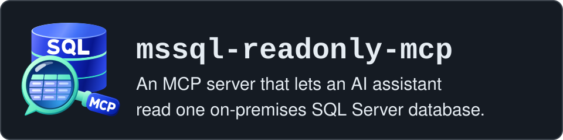

[](https://github.com/oguzhanpisgin/mssql-readonly-mcp/actions/workflows/ci.yml) [](LICENSE)  [](#1-prerequisites)

# mssql-readonly-mcp

An MCP server that lets an AI assistant read one on-premises SQL Server database.
Its SQL tool accepts only text that passes an allowlist for one plain SELECT, and it will not start with a login
that fails its permission check (see ["What `check-login` refuses"](docs/login-check.md#what-check-login-refuses) for what that check covers and what it does not).
It keeps a tamper-evident record (a hash-chained audit file) of every question asked.

Status: early release, actively maintained. Tested on SQL Server 2019, 2022 and 2025 (Linux container images) on
every change; what it promises, what it does not solve and how it was tested (["Building and testing"](docs/building-and-testing.md)) are written
below.


## What it promises

Each promise in short; the full text, with the test files that check it, is in [docs/promises.md](docs/promises.md).

- **A write or DDL statement is refused before it reaches SQL Server**, by an allowlist over the ScriptDom syntax
  tree, not a keyword filter ([full text](docs/promises.md#writes-refused-before-sql-server)).
- **In every case tested, SQL Server ran the allowed text or refused it before running**
  ([full text](docs/promises.md#allowed-text-on-a-real-sql-server)).
- **The server refuses to start with a login that fails its permission check**: exit code 3, no override
  ([full text](docs/promises.md#login-check-at-startup); what it covers: [docs/login-check.md](docs/login-check.md)).
- **No call returns data before its hash-chained audit line is written.** If the line cannot be written, the query
  has still run and the call returns an error and no data ([full text](docs/promises.md#audit-line-before-data)).
- **Results are capped by rows, characters and time** ([full text](docs/promises.md#result-caps)).
- **A query waits a bounded time for locks and loses deadlocks against default-priority sessions.** Its own shared
  locks can still make a writer wait, until the call ends, and for a call ended as `Timeout` or `Cancelled` at
  its cutoff until its clean-up at SQL Server ends, which can be after the answer; up to v0.1.0, on a slow link a
  `Timeout` could leave them longer, with its session, which v0.1.1 closes, best effort
  ([U-1R](SECURITY.md#known-limits); [full text](docs/promises.md#lock-timeout-and-deadlock-priority)).

How each promise is checked, and where. Test counts are kept in one place,
[Building and testing](docs/building-and-testing.md); the CI badge above shows the result of the last run on `main`.

| Promise | How it is checked | Where |
| --- | --- | --- |
| A write or DDL statement is refused before it reaches SQL Server | Allowed and refused rows, the public bypass classes among them; every statement type in the ScriptDom assembly; on a real SQL Server, refused statements open no connection and change nothing, and an Extended Events trace of the reader login shows no batch, RPC or login event for them | [RegressionTableTests.cs](tests/MssqlReadOnlyMcp.Gate.Tests/RegressionTableTests.cs), [StatementTypeTests.cs](tests/MssqlReadOnlyMcp.Gate.Tests/StatementTypeTests.cs), [GateRefusalTests.cs](tests/MssqlReadOnlyMcp.IntegrationTests/GateRefusalTests.cs), [ExtendedEventsTests.cs](tests/MssqlReadOnlyMcp.IntegrationTests/ExtendedEventsTests.cs) |
| SQL Server ran the allowed text or refused it before running | Every allowed row of the regression table is sent to SQL Server as the reader; lexer cases (invisible and separator characters, comment and string forms, ODBC escapes) are sent too, and the test asserts exactly how many end each way | [DifferentialTests.cs](tests/MssqlReadOnlyMcp.IntegrationTests/DifferentialTests.cs), [ParserVersusServerLexerTests.cs](tests/MssqlReadOnlyMcp.IntegrationTests/ParserVersusServerLexerTests.cs) |
| The server refuses to start with a login that fails its permission check | Started with `sa`, the process exits 3 with one stderr line | [StdioServerTests.cs](tests/MssqlReadOnlyMcp.IntegrationTests/StdioServerTests.cs), [PermissionCheckTests.cs](tests/MssqlReadOnlyMcp.IntegrationTests/PermissionCheckTests.cs) |
| No call returns data before its audit line is written | One line per call plus one startup line; no data when the audit file fails | [AuditTests.cs](tests/MssqlReadOnlyMcp.IntegrationTests/AuditTests.cs), [StdioServerTests.cs](tests/MssqlReadOnlyMcp.IntegrationTests/StdioServerTests.cs), [MssqlReadOnlyMcp.Audit.Tests](tests/MssqlReadOnlyMcp.Audit.Tests) |
| Results are capped by rows, characters and time | Row cap, character cap, cell cut, time limit per call, lock timeout; a row that cannot fit the character cap is not held whole in memory, but the cells read and the rest of the row still cross the network; a call on a frozen, throttled or held connection is answered as `Timeout` within its time limit plus 2.5 s (the tests' bound; a truncated result whose reader close freezes is answered `ok` with the rows read before the limit), and its clean-up at SQL Server can go on after the answer; in attack test run 4, many calls frozen at once in the middle of a row delayed the answers of every call: at a limit of 5 s with 60 or 120 such calls, the median answer came after 8.2 to 30.2 s (run 5, with 60: 10.2 to 12.1 s; U-2 in [Security testing](docs/security-testing.md)) | [CapsTests.cs](tests/MssqlReadOnlyMcp.IntegrationTests/CapsTests.cs), [CallLimitTests.cs](tests/MssqlReadOnlyMcp.IntegrationTests/CallLimitTests.cs), [StdioServerTests.AnswerAtTheLimit.cs](tests/MssqlReadOnlyMcp.IntegrationTests/StdioServerTests.AnswerAtTheLimit.cs) |
| Bounded lock wait, low deadlock priority | An exclusive lock held elsewhere returns the lock timeout reason near the limit; against a session at the default priority the reader is the deadlock victim, and the next call works | [CapsTests.cs](tests/MssqlReadOnlyMcp.IntegrationTests/CapsTests.cs), [ValueTypeTests.cs](tests/MssqlReadOnlyMcp.IntegrationTests/ValueTypeTests.cs) |
| Tested on SQL Server 2019, 2022 and 2025 | On every push and pull request: the build and unit tests, then, when they pass, the integration tests on each of three container images pinned by exact tag | [ci.yml](.github/workflows/ci.yml); test counts in [Building and testing](docs/building-and-testing.md); the CI badge above |
| Code scanning | CodeQL analyses the C# code and the workflow files on pushes to `main`, on pull requests and once a week | [codeql.yml](.github/workflows/codeql.yml) |
| The login check's refusals | Logins holding refused rights, among them `sa`, `db_owner`, `db_datawriter`, single table and column `UPDATE`, `IMPERSONATE` and `UNMASK`, get their exact findings; the reader passes | [PermissionCheckTests.cs](tests/MssqlReadOnlyMcp.IntegrationTests/PermissionCheckTests.cs); the full list in [docs/login-check.md](docs/login-check.md) |
| The audit chain | Format, chain, verification, flush and single writer; `verify-audit` exits 0 on a file the server wrote and 1 on a tampered copy | [MssqlReadOnlyMcp.Audit.Tests](tests/MssqlReadOnlyMcp.Audit.Tests), [StdioServerTests.cs](tests/MssqlReadOnlyMcp.IntegrationTests/StdioServerTests.cs); [docs/audit-log.md](docs/audit-log.md) |
| Startup with 20,000 tables | A second database with 20,000 tables; the startup check must pass there within the default connection timeout (15 s) | [ErpScaleTests.cs](tests/MssqlReadOnlyMcp.IntegrationTests/ErpScaleTests.cs); measured times in [Building and testing](docs/building-and-testing.md) |


## What it does not solve

Read this before you install it.

- **The rows the assistant reads leave your building.** They go to the AI vendor that runs the model, with the
  table and column names and any SQL Server error text. Read-only does not change that.
- **Personal data and cross-border transfer rules are the firm's decision.** In Turkey that is KVKK; other countries
  have their own rules. This project does not decide what may be sent.
- **The answer this project offers is the login.** `scripts/create-readonly-login.sql` creates a login that gets
  SELECT only on the tables and views the firm lists in the script. SQL Server shows that login only the user
  tables and views it holds a permission on, plus the names of objects that ship with SQL Server; a table without a
  grant is not found by `describe_table`, not listed by `list_tables` and not in `sys.objects` (`SchemaToolTests.cs`,
  `Table_without_a_grant_is_not_found_not_listed_and_not_in_sys_objects`).
- **A `run_query` error can show that a table without a grant exists, and its column names** (errors 229, 208, 207; no row data): [details](docs/reference.md#error-reasons).
- **A read can leave an auto-created statistics object behind after the rollback**: [details](SECURITY.md#two-layers).
- **The login sees what SQL Server shows `public`**, such as the host name and every database name: [details](docs/reference.md#what-the-reader-sees-at-server-level).
- **The login check runs once, at start**; rights granted later are not seen until a restart: [details](docs/login-check.md).

More limits are in [SECURITY.md](SECURITY.md).

## Five-minute start

Four steps: download the program, create its read-only login and check it, connect your client, ask. The blocks are
for Windows and PowerShell 7; Linux and macOS forms, building from source and what was tested are in
[Installing](docs/install.md).

### 1. Prerequisites

- A SQL Server the machine can reach. The integration tests passed on 2026-11-13 on three Linux container images:
  `mcr.microsoft.com/mssql/server:2019-CU32-GDR13-ubuntu-20.04`, `2022-CU27-ubuntu-22.04` and
  `2025-CU9-GDR1-ubuntu-22.04`. Other versions and Windows installations were not tested. One of those tests is not
  stable; the failures whose message was captured after v0.1.0 had a cause other than U-1R (both in
  [SECURITY.md](SECURITY.md#known-limits)).
- On SQL Server 2019 some allowed syntax is newer than the server; it fails there with an error and nothing runs
  (["Syntax newer than SQL Server 2019"](docs/sql-gate.md#syntax-newer-than-sql-server-2019)).
- `sqlcmd`, to run the login script as a database administrator; Microsoft's page "Download and install the sqlcmd
  utility" (<https://learn.microsoft.com/en-us/sql/tools/sqlcmd/sqlcmd-download-install>) lists where to get it.
- PowerShell 7.1 or later (`Read-Host -MaskInput`).
- No .NET SDK: each release archive includes the .NET runtime. Starting it on a machine with no .NET installed at
  all has not been tested yet ([Releasing](docs/releasing.md#not-yet-verified)).

Download the Windows archive of the release, check it against `SHA256SUMS` and unpack it to a folder `tools` in your
profile folder (`$HOME\tools`). That folder should be writable only by the account that installs the program,
because every client starts the executable in it: a folder created at the drive root, such as `C:\tools`, normally
lets every signed-in user replace its files, a folder in your profile does not.

```powershell
$v = '0.1.1'; $name = "mssql-readonly-mcp-$v-win-x64"
$base = "https://github.com/oguzhanpisgin/mssql-readonly-mcp/releases/download/v$v"
Invoke-WebRequest "$base/$name.zip" -OutFile "$name.zip"; Invoke-WebRequest "$base/SHA256SUMS" -OutFile SHA256SUMS
if ((Get-FileHash "$name.zip").Hash -ne (Select-String -SimpleMatch "$name.zip" SHA256SUMS).Line.Split(' ')[0]) { throw 'SHA-256 does not match SHA256SUMS' }
Expand-Archive "$name.zip" "$HOME\tools"; Rename-Item "$HOME\tools\$name" mssql-readonly-mcp
$exe = "$HOME\tools\mssql-readonly-mcp\mssql-readonly-mcp.exe"
```

The program is `$HOME\tools\mssql-readonly-mcp\mssql-readonly-mcp.exe`; the next steps use `$v`, `$base`, `$exe` and
`SHA256SUMS`: in a new session, set the three variables again in the folder that holds `SHA256SUMS`. The
executable is not Authenticode-signed. The client blocks below assume this folder
and audit files in a folder `mcp-audit` in your profile folder: `$HOME/...` in PowerShell commands,
`C:/Users/<you>/tools/...` and `C:/Users/<you>/mcp-audit/...` in configuration files, with `C:/Users/<you>` replaced
by the folder `$HOME` prints, written with forward slashes; if yours differ, change those paths. The audit folder
should be readable and writable only by the account that runs the server: a folder created at the drive root, such
as `C:\mcp-audit`, normally lets every signed-in user read and change its files, a folder in your profile does not.

### 2. Create and check the read-only login

This step is the product's safety step: the server reads with this login only, and will not start with a login
that fails its permission check. Download the login script of the release and open it:

```powershell
Invoke-WebRequest "https://raw.githubusercontent.com/oguzhanpisgin/mssql-readonly-mcp/v$v/scripts/create-readonly-login.sql" -OutFile create-readonly-login.sql
notepad create-readonly-login.sql
```

Its `GRANT SELECT ON OBJECT::...` lines are examples (a GRANT on an object that does not exist stops the script):
replace them with one line per table or view of yours the assistant may read, and save. Then create the login as an
administrator (Windows authentication, `-E`) and check it, in one block. In the block, replace the example server
`sql.example.local` (twice) and database `ExampleDb` (twice) with yours. The password is typed once, into a masked
prompt, and stays in environment variables of this session, never in a file or on a command line:

```powershell
$env:MCP_LOGIN = 'mcp_reader'; $env:MCP_DATABASE = 'ExampleDb'
$env:MCP_PASSWORD = Read-Host -MaskInput 'New password for mcp_reader'
sqlcmd -S sql.example.local -E -b -i create-readonly-login.sql
$env:MSSQL_CONNECTION_STRING = "Server=sql.example.local;Database=ExampleDb;User ID=mcp_reader;Password=$env:MCP_PASSWORD"
Remove-Item Env:MCP_PASSWORD
& $exe check-login
```

With a SQL Server administrator login instead of `-E`: [Installing](docs/install.md#a-sql-server-administrator-login).
Keep this PowerShell window open: step 3 uses `MSSQL_CONNECTION_STRING` from it.

Microsoft.Data.SqlClient encrypts the connection and checks the server certificate by default. An untrusted
certificate shows as exit code 4 with `SqlException number -2146893019` (seen on Windows with a self-signed
certificate). Install a trusted certificate, or, for a test server, add `TrustServerCertificate=True` to the
connection string and `-C` to `sqlcmd` (sqlcmd 18), and accept that a machine in the middle is then not detected.

The script prints `Created login mcp_reader.` and `Created user mcp_reader in database ExampleDb.`, then lists the
permissions the user now holds and its role memberships (expected: none). It sets the login's default database to
`MCP_DATABASE`. A second run prints `Login mcp_reader exists; its password was not changed.` and reuses the user.
It stops with an error if the user belongs to another login or is in any role. `StdioServerTests.cs`
(`Setup_script_creates_a_login_that_passes_check_login_and_runs_twice`) runs this file unchanged in the test
container with `sqlcmd` from a Linux shell, then `check-login` (exit 0), then the file a second time. The PowerShell
block above was not run as a whole: its `check-login` line was run with a release build on 2026-11-13
([Installing](docs/install.md#what-was-tested)).

Do not add the login to `db_datareader`. See ["What `check-login` refuses"](docs/login-check.md).

Exit code 0 and `Login mcp_reader on database ExampleDb: passed, no permission to change data was found.` means you
can go on. Exit code 3 prints `Login mcp_reader on database ExampleDb: refused, <n> right(s) outside the read-only
set found:`, then each finding on its own line after two spaces, for example `  UNMASK on database ExampleDb`; fix
those grants and run it again (`Program.cs`). When the server itself refuses to start, it exits 3 with one stderr
line that points to this command (`ServerStartup.cs`):

```text
mssql-readonly-mcp: refusing to start: the login holds rights beyond read-only access (2 findings, first: <finding>). Run 'mssql-readonly-mcp check-login' for the full list.
```

How findings are printed, what the pass line does not prove, and every exit code:
["Commands and exit codes"](docs/reference.md#commands-and-exit-codes).

### 3. Connect your client

Every client starts the program itself and passes it two variables: `MSSQL_CONNECTION_STRING` and
`MSSQL_MCP_AUDIT_LOG`. Where the connection string is kept differs per client:

| Client | Where the connection string is kept | Tested by this project |
| --- | --- | --- |
| [Claude Desktop](#claude-desktop) | The operating system's credential store (the bundle marks it `sensitive`) | A bundle built before v0.1.0 (no bundle of a published release) installed in the Microsoft Store build; its server answered `tools/list`; a tool call typed in the chat window not shown |
| [Claude Code](#claude-code) | Plain text, in Claude Code's own file in your home folder | Yes: listed as connected |
| [Codex CLI and the ChatGPT desktop app](#codex-cli-and-the-chatgpt-desktop-app) | Nowhere: forwarded from the environment Codex starts in | The entry is listed; the forwarding is documented, not tested |
| [VS Code with GitHub Copilot](#vs-code-with-github-copilot) | Asked when the server first starts, then kept by VS Code | Documented; the program was started with the block's command |
| [Cursor](#cursor) | Nowhere: read from Cursor's environment | Documented; the program was started with the block's command |

Dates, versions and sources: [Installing, "What was tested"](docs/install.md#what-was-tested).

An audit file has one writer at a time, locked through a companion `<audit file>.lock` beside it (for example
`claude-code.jsonl.lock`), which stays after the server exits. On Windows, a second server process started with the
same audit file writes a sibling file instead (`claude-code.2.jsonl` beside `claude-code.jsonl`), each file with its
own chain, and says so in one line on stderr; on Linux the same code path has run only in the repository's tests,
which passed in CI on Ubuntu on 2026-11-13. On macOS the second
process exits 2 because the file is locked ([The audit log](docs/audit-log.md#several-server-processes-on-one-audit-path)).

#### Claude Desktop

In the PowerShell window of step 1, or a new one set up again as step 1 says, download the bundle (`.mcpb`) of the
same release to your Downloads folder and check it:

```powershell
Invoke-WebRequest "$base/mssql-readonly-mcp-$v-win-x64.mcpb" -OutFile "$HOME\Downloads\mssql-readonly-mcp-$v-win-x64.mcpb"
if ((Get-FileHash "$HOME\Downloads\mssql-readonly-mcp-$v-win-x64.mcpb").Hash -ne (Select-String -SimpleMatch "mssql-readonly-mcp-$v-win-x64.mcpb" SHA256SUMS).Line.Split(' ')[0]) { throw 'SHA-256 does not match SHA256SUMS' }
```

Open it in Claude Desktop:

```powershell
claude-desktop.exe "$HOME\Downloads\mssql-readonly-mcp-$v-win-x64.mcpb"
```

This command, with the bundle's full path, opened the install page on Windows 11 with the Microsoft Store build
5.11492.2.0 of Claude Desktop; Anthropic does not document it. If it does nothing or PowerShell does not recognise
it, use the menu in the app instead: **Settings > Extensions > Advanced settings > Install Extension…**, and pick
the file in your Downloads folder.

The install page warns that the source is unsigned; install it. Then fill in the two fields and save them; if they
do not appear after the install, open them with the configure button on the extension's page:

- **SQL Server connection string**: `Server=<host>;Database=<database>;User ID=mcp_reader;Password=<password>`,
  the form of step 2 with the password typed in. Paste only this text.
- **Audit file path**: `C:\Users\<you>\mcp-audit\claude-desktop.jsonl` (step 1).

The Store build tested started the server twice, so on Windows its record can be two files, `claude-desktop.jsonl`
and `claude-desktop.2.jsonl` ([The audit log](docs/audit-log.md#several-server-processes-on-one-audit-path)).

If the server does not start, open the log view on the extension's page: it names the configuration error without
repeating the connection string. Other cases, such as extensions turned off by an organisation: [Installing](docs/install.md#claude-desktop).

#### Claude Code

In the PowerShell window of step 2, in the folder where you start `claude`:

```powershell
claude mcp add -e "MSSQL_CONNECTION_STRING=$env:MSSQL_CONNECTION_STRING" -e "MSSQL_MCP_AUDIT_LOG=$HOME/mcp-audit/claude-code.jsonl" --transport stdio mssql-readonly -- $exe
claude mcp list
```

`claude mcp list` should show `mssql-readonly: ... - ✔ Connected`. The shell history keeps the variable's name,
not the password; while `claude mcp add` runs, the password is on its command line, which other processes running
as you can read; Claude Code stores the value in plain text in its own file `.claude.json` in your home folder, for
this folder only (the default `local` scope), readable by any process running as you. A project `.mcp.json` with
`${MSSQL_CONNECTION_STRING}` is not used here: with Claude Code 2.1.323 such a reference reached the server empty
([Installing](docs/install.md#claude-code)).

#### Codex CLI and the ChatGPT desktop app

They share one configuration file, `~/.codex/config.toml` (`%USERPROFILE%\.codex\config.toml`). Add:

```toml
[mcp_servers.mssql-readonly]
command = 'C:/Users/<you>/tools/mssql-readonly-mcp/mssql-readonly-mcp.exe'
env_vars = ["MSSQL_CONNECTION_STRING"]
env = { MSSQL_MCP_AUDIT_LOG = 'C:/Users/<you>/mcp-audit/codex.jsonl' }
```

`env_vars` forwards the variable from the environment Codex was started in, so the password is not in the file:
start `codex` from the PowerShell window of step 2. (`codex mcp add` takes only `--env NAME=value`, which would
store the value.) The ChatGPT desktop app is not started from that window; it sees the variable only if it is set
for your user ([Installing](docs/install.md#keep-the-connection-string-for-your-user)).

#### VS Code with GitHub Copilot

`.vscode/mcp.json` in your workspace:

```json
{
  "inputs": [
    {
      "type": "promptString",
      "id": "mssql-connection-string",
      "description": "SQL Server connection string of the read-only login",
      "password": true
    }
  ],
  "servers": {
    "mssql-readonly": {
      "type": "stdio",
      "command": "C:/Users/<you>/tools/mssql-readonly-mcp/mssql-readonly-mcp.exe",
      "env": {
        "MSSQL_CONNECTION_STRING": "${input:mssql-connection-string}",
        "MSSQL_MCP_AUDIT_LOG": "C:/Users/<you>/mcp-audit/vscode.jsonl"
      }
    }
  }
}
```

VS Code asks for the connection string in a hidden input when the server first starts, and keeps it for later
starts. VS Code's page marks this file as the format of its deprecated "Local harness" (removal planned for
February 2027): [Installing](docs/install.md#vs-code-with-github-copilot).

#### Cursor

`.cursor/mcp.json` in your project (or `~/.cursor/mcp.json` for every project):

```json
{
  "mcpServers": {
    "mssql-readonly": {
      "type": "stdio",
      "command": "C:/Users/<you>/tools/mssql-readonly-mcp/mssql-readonly-mcp.exe",
      "env": {
        "MSSQL_CONNECTION_STRING": "${env:MSSQL_CONNECTION_STRING}",
        "MSSQL_MCP_AUDIT_LOG": "C:/Users/<you>/mcp-audit/cursor.jsonl"
      }
    }
  }
}
```

Cursor reads `${env:MSSQL_CONNECTION_STRING}` from its own environment: quit Cursor and start it from the PowerShell
window of step 2, or set the variable for your user
([Installing](docs/install.md#keep-the-connection-string-for-your-user)).

### 4. First question

Ask: "Use the mssql-readonly tools. List the tables, describe the orders table, then show the ten most recent
orders with their customer names."

Then verify the audit file of your client, and every sibling file beside it if there is one
([The audit log](docs/audit-log.md#several-server-processes-on-one-audit-path)). The files of the blocks above are
`claude-desktop`, `claude-code`, `codex`, `vscode` and `cursor`, each with `.jsonl`; replace `claude-code` with yours:

```powershell
Get-ChildItem "$HOME/mcp-audit" -Filter 'claude-code*.jsonl' | ForEach-Object { & $exe verify-audit $_.FullName }
```

For each file it prints `Audit file <name>: <N> lines verified.` (exit code 0), or names the first bad line and a
reason word (exit code 1) (see ["The audit log"](docs/audit-log.md)); no output means no file was found.

One recorded Claude Code run against an invented database, with each tool call, a refused `UPDATE` and the audit
lines, is in [docs/demo.md](docs/demo.md).

## Documentation

- [What it promises](docs/promises.md): the full text of each promise and the test files that check it.
- [Installing](docs/install.md): Linux and macOS, each client in more detail, updating, building from source, and
  what was tested.
- [Reference](docs/reference.md): configuration, commands and exit codes, tools, result limits, error reasons.
- [What SQL is allowed](docs/sql-gate.md): the syntax and function names the gate allows, and its other checks.
- [What `check-login` refuses](docs/login-check.md): what the login check refuses, allows and does not inspect.
- [The audit log](docs/audit-log.md): the line format, what a line leaves out, `verify-audit`, and the limits.
- [Prior art, and when to prefer it](docs/prior-art.md): two related servers, and when to use them instead.
- [Building and testing](docs/building-and-testing.md): build and test commands, test counts, measured times.
- [Security testing](docs/security-testing.md): attack tests, scans and code review, results, and what was not tested.
- [Demo](docs/demo.md): one recorded Claude Code run against an invented database.
- [Releasing](docs/releasing.md): for the maintainer, how the release workflow builds a draft release and how it is published by hand.

## Try to break it

If you get a write, a schema change, a read outside the connected database, or a call with no audit line through
this server, please report it. A request the MCP SDK drops or rejects before the server sees it runs no tool and
gets no line: not a finding ([list](docs/audit-log.md#requests-with-no-audit-line)); a tool that ran without a line is.
Send this, as plain text:

```
Exact text sent (the run_query sql argument, or the tool and its arguments):
What you expected:
What happened (tool result text, exit code, anything that changed on the server):
SQL Server version (SELECT @@VERSION, run separately):
Server commit or version:
The audit line for the call (or "none"):
```

Where to send it: privately, through GitHub private vulnerability reporting (the "Report a vulnerability"
button under the Security tab of <https://github.com/oguzhanpisgin/mssql-readonly-mcp>), as
[SECURITY.md](SECURITY.md) "Reporting a problem" describes. Please do not open a public issue for it.

## Support and maintenance

- Questions and bugs: [GitHub Issues](https://github.com/oguzhanpisgin/mssql-readonly-mcp/issues), through the forms
  described in [CONTRIBUTING.md](CONTRIBUTING.md). The maintainer reads and answers them, with no set time and no
  promise that a pull request is merged.
- Security reports: privately, through GitHub private vulnerability reporting (the "Report a vulnerability" button
  under the Security tab), as [SECURITY.md](SECURITY.md) "Reporting a problem" describes. We aim to answer within
  3 days; this is an aim, not a guarantee, and it is for security reports only.
- Fixes land in the latest release ([Releases](https://github.com/oguzhanpisgin/mssql-readonly-mcp/releases));
  versions follow semantic versioning.
- Listed in the official MCP registry as `io.github.oguzhanpisgin/mssql-readonly-mcp`, with the release's three
  `.mcpb` bundles ([server.json](server.json)).
- One maintainer today (GitHub account `oguzhanpisgin`). MIT licence, no warranty (see [LICENSE](LICENSE)): test
  against your own server before you rely on it.
- Most of the code and the documentation were written with AI coding assistants, directed by the maintainer.
- Maintainer profile: [oguzhanpisgin](https://github.com/oguzhanpisgin); contact goes only through the two channels above.

This is an independent project, not affiliated with or endorsed by Microsoft, Anthropic or any other vendor;
product names are trademarks of their owners.

## Licence

MIT. See [LICENSE](LICENSE).
